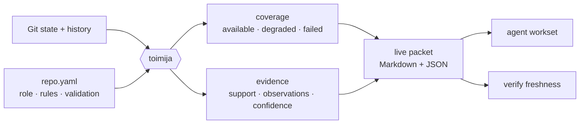
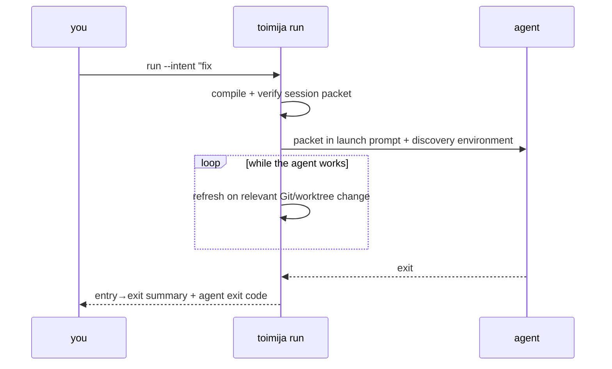

# Toimija

**A Git-native context compiler and live entrypoint for coding agents.**


*Toimija* is Finnish for “the one who acts.”

> We do not ask the model to understand the repo first. We ask Git what state the repo is in.

Coding agents usually enter a repository by globbing, grepping, reading, and
guessing. That cold crawl costs time and tokens, duplicates work across agents,
and can silently reason from stale or incomplete state.

Toimija compiles the repository’s local Git state, history, configuration, and
validation conventions into one bounded packet. The packet tells an agent what
to read, what changed, how strong the evidence is, where collection failed, and
whether the packet still matches the live worktree.

Git is not a save button here. Git is the substrate.

> Git gives us the graph of what happened. Toimija turns that graph into operational context for agents.

## Start in 30 seconds

```bash
cargo install --path .
cd /path/to/repo
toimija init                              # once: seed .toimija/repo.yaml
toimija adopt --hooks                     # once: teach agents the entry rule
toimija run --intent "fix #51" -- codex   # every session: wrap the agent
```

`run` compiles and verifies a session packet, delivers it in the launch prompt
for known agents (`claude`, `codex`, and `gemini`), keeps it fresh while the
agent works, and exits with the wrapped command’s status plus an entry-to-exit
summary.

Use `--task` to include the concrete assignment:

```bash
toimija run \
  --intent "fix authentication regression" \
  --scope src/auth/ \
  --task "repair the expired-session redirect" \
  -- codex
```

## The packet is the product

Every packet is available as readable Markdown and complete JSON:

```text
.toimija/current.md
.toimija/current.json
.toimija/sessions/<id>/current.md
.toimija/sessions/<id>/current.json
```

It combines:

- branch, HEAD, merge-base, index, worktree, conflicts, and untracked state;
- the branch surface and recent commits;
- a Git-derived workset and ordered reading plan;
- coupling and risk hints with visible evidence and confidence;
- collection coverage, including degraded and failed observations;
- configured boundaries, exclusions, and validation commands;
- session identity, declared intent, scope, and entry-state drift;
- a content-based consistency token and provenance envelope.

A typical agent sees the contract before the detail:

```markdown
## Workset contract
Work from this packet's Scope and Read order; they are your working set, not a
preamble. Configured exclusions are do-not-scan. You MAY read outside the
workset when a concrete unresolved dependency requires it — but you MUST
declare the expansion first. Expansion is never forbidden; invisible expansion
is.
```

That changes the packet from helpful background into an operational boundary.
The agent starts from compiled evidence and only widens its search when the task
actually requires it.



## Trust is explicit

Toimija does not turn missing data into reassuring output.

- **Collection coverage:** a collector reports `available`, `degraded`, or
  `failed`. An empty successful observation is different from a failed
  collection, and failed collection cannot support a positive or negative
  claim.
- **Evidence-backed relevance:** coupling and risk hints expose their source,
  support, observation count, and confidence. Weak hints are suppressed instead
  of padded into a longer list.
- **Verifiable freshness:** `toimija verify` checks a content-based consistency
  token against the current Git state. Same-size edits cannot hide behind file
  metadata, and a bare timestamp change does not create false staleness.
- **Honest budgets:** Markdown omits optional sections whole and reports exactly
  what was omitted. JSON remains complete; safety state is never clipped to fit
  a token budget.
- **Fixed session baseline:** a session retains its entry branch and HEAD. Later
  movement appears as drift rather than rewriting history.
- **Chain of custody:** packets and handoffs carry a canonical sauma digest and
  provenance edges tied to the repository state that produced them.

The result is not merely a smaller prompt. It is a context artifact whose
claims can be inspected and verified.

## One live packet per agent



Each wrapped agent gets a packet under `.toimija/sessions/<id>/`; concurrent
agents do not race on one shared context file. `toimija sessions` shows live,
stale, and closed sessions plus overlap warnings. `toimija intent` records a
mid-session scope expansion, and `toimija handoff` leaves a versioned record for
whoever continues the work.

When a session concludes, Toimija appends a compact record to
`.toimija/history.jsonl` before its directory can be reclaimed. `toimija
history` keeps intent and handoff memory available after live artifacts are
gone; malformed records degrade the listing instead of hiding valid history.
`toimija clean --dry-run` previews the same bounded stewardship pass that
`enter` and `run` perform best-effort: expired sessions are journaled before
deletion, old run transcripts are removed after 14 days, and exact orphaned
atomic-write temp files are removed after one hour.

This is awareness, not orchestration. Toimija never assigns work, dispatches an
agent, blocks a sibling, or kills a process. Session state is read and written
synchronously while an explicit command is running; the human remains the
orchestrator.

Before commit or handoff:

```bash
toimija verify
```

## Bounded work with Teko

Teko keeps one ratified task active across agent restarts and interrupted
`toimija run` sessions. Its status is derived from the current product tree;
Toimija's generated packets, session records, history, and Teko database do not
count as worktree changes.

```bash
teko new \
  --title "Fix login" \
  --objective "Repair the redirect" \
  --goal regression="A regression test covers the fix" \
  --non-goal "Redesign authentication" \
  --gate test="cargo test" \
  --completion validated \
  --ratify
teko start --scope src/auth --scope tests
teko show
toimija run -- codex
teko verify --claim regression
teko close
```

`show` prints stable closure-blocker IDs and one copy-pasteable next command.
Toimija reads active work from the standalone `teko show --json` command,
embeds it as structured, attested session data in every packet, and includes it
in known agents' launch prompts. Kisko consumes that data as its durable task
contract, refreshes it through Toimija after writes, and accepts completion
only when Teko is closable. `teko <command> --help` documents each step and
includes an example.

## Commands

| Command | Purpose |
| --- | --- |
| `run --intent "..." -- <agent>` | Compile, deliver, refresh, and summarize a wrapped agent session. |
| `enter`, `context`, `refresh`, `watch` | Produce or maintain the live packet directly. |
| `repository-point`, `explain-work` | Export versioned repository truth or explain active shared work (`--json` for machines). |
| `verify`, `snapshot` | Verify live state or freeze the worktree as a Git object. |
| `sessions`, `intent`, `handoff` | Observe sessions, declare scope, and record continuation context. |
| `history` | List durable records of concluded sessions; `--json` emits all valid records. |
| `teko` (standalone) | Persist, resume, verify, and honestly close one bounded work item. |
| `clean` | Reclaim expired owned artifacts; `--dry-run` lists candidates without changing disk. |
| `audit-plan` | Partition broad reviews into bounded deterministic worksets. |
| `validate --plan` | Render inferred and configured validation commands; never execute them. |
| `landed` | Check whether branch content landed even when squash merges hide ancestry. |
| `init`, `adopt`, `doctor` | Configure a repo, install the entry rule, and detect policy drift. |

The foreground watch loop survives laptop sleep: a resumed session re-proves
itself within one tick through the same refresh and heartbeat path as a file
change. Its armed line names the probe-proven native backend or polling fallback.
Linux ARM64 uses polling because its native runner backend drops post-probe events.

See the **[complete reference](docs/reference.md)** for every flag, environment
variable, packet field, and output guarantee.

## Language support

Rust and Elixir have full adapters. Go, Python, and JavaScript/TypeScript receive
the minimum language pack: repository detection, evidence-backed validation-plan
hints, and companion-test discovery. Commands without the required repository
evidence are omitted with a note. Other repositories work through
`.toimija/repo.yaml`.

All recognized languages live in one compile-time registry. Basic support is
one kind plus one data row; a dedicated adapter is needed only for project-aware
behavior.

Packets also report recognized secondary languages from a bounded manifest
walk. Secondary observations do not change the primary kind or validation plan.

Adapters contribute hints; they do not parse source code. Git-derived context
remains the common substrate across languages.

## Boundaries

The boundaries are part of the trust model:

- no network calls or implicit fetches;
- no background daemon—`watch` and `run` exist only while invoked;
- no MCP, LSP, Tree-sitter, SCIP, Kythe, or hidden source index;
- no model-provider calls, prompt ownership, or patch application;
- no automatic execution of validation commands;
- no task dispatch, assignment, or agent orchestration.

Relevance remains file-level, heuristic, and advisory. Coverage describes what
Toimija successfully observed, not omniscience about the repository. Those
limits are rendered instead of hidden.

## Development status

Toimija is currently a v0.1 Rust CLI being prepared for public use. It is one
crate, local-first, and intentionally small enough to audit. The Markdown packet
is the human interface; JSON is the complete machine-readable contract and
evolves additively within a schema version.

```bash
cargo fmt --check
cargo clippy --workspace --all-targets -- -D warnings
cargo test --workspace
cargo xtask install-pre-commit-hook   # once per clone
```

Design history lives in [`docs/proposals/`](docs/proposals/). The cross-tool
packet contract is documented in
[`docs/joskus-contract.md`](docs/joskus-contract.md).
