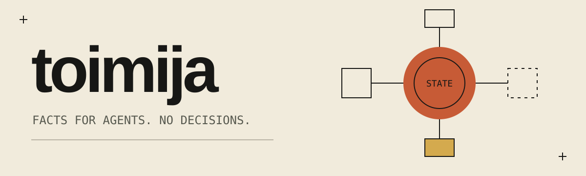
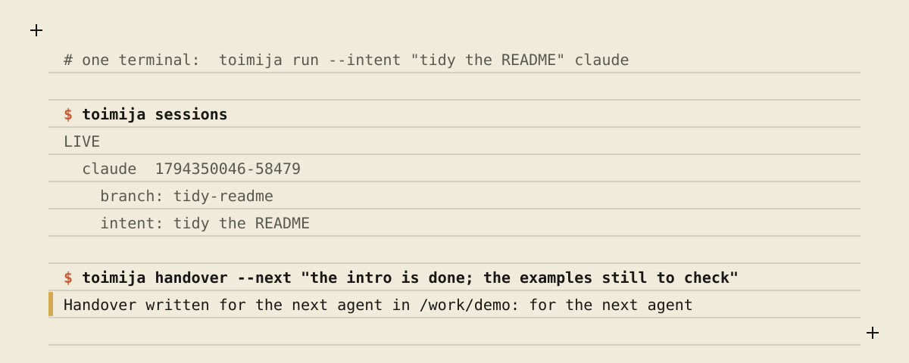
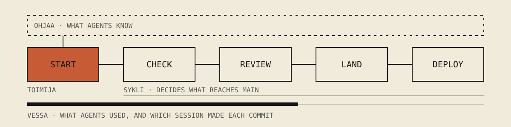

# toimija

Toimija is a command-line tool that gives a coding agent the facts of the Git
repository it works in.

It is for a person who works with coding agents such as Claude Code, Codex, pi
or opencode, at the moment they start one in a repository and want it to know
where it is. It needs `git`, an agent CLI, and Rust for a source install.

> We do not ask the model to understand the repo first. We ask Git what state the repo is in.

A coding agent usually enters a repository by listing, searching and guessing.
That is slow, every agent repeats it, and the result is out of date as soon as
the repository moves. Toimija reads the repository's state once and writes a
short packet: the branch, the changed files, what to read first and how to
validate. It starts the agent with that packet and keeps it current while the
agent works. It shows which other sessions are in the same repository, and
carries a note from one agent to the next. In a folder that holds several
repositories, it gives the agent the facts of the folder instead: each
repository, its branch, and who is working where.

Git is not a save button here. Git is the substrate.
Git gives us the graph of what happened. Toimija turns that graph into operational context for agents.

## See it



<details><summary>The same, as text</summary>

```console
# one terminal:  toimija run --intent "tidy the README" claude

$ toimija sessions
LIVE
  claude  1794350046-58479
    branch: tidy-readme
    intent: tidy the README

$ toimija graph
* 4191206  tidy-readme  proven    review: none       claude live: "tidy the README"
* 3588810  origin/main  proven    review: fine
```

</details>

The packet a session reads (shortened here):

```console
$ toimija context
# Toimija Context
- compiled-from: 2 changed file(s), 3 recent commit(s) — reading this replaces that discovery

## Repo
- name: demo
- role: service that signs users in
- kind: Rust

## Last handover
- written: 2026-11-10 14:30 UTC on fix/login-redirect at 0cb97f9
- for the next agent: the redirect is fixed; tests still to write

## Git
- branch: fix/login-redirect
- merge-base: main @ 199d5873d4180dfb0c076ac555e1686e74920b7a
- dirty: true
- staged: 0
- unstaged: 1
- untracked: 0

## Read first
- README.md (important doc)
- .toimija/repo.yaml (changed)
- src/auth.rs (changed)
- tests/auth.rs (matching test heuristic)

## Validation plan
- source: inferred
### Fast
- cargo test --workspace
```

## Install

Toimija builds from source with cargo. The repository pins its Rust toolchain
(1.98) in `rust-toolchain.toml`, and `rustup` installs that version on the
first build. It also needs `git` on the path.

```bash
git clone https://github.com/false-systems/toimija.git
cd toimija
cargo install --path .
```

Toimija is not on crates.io yet. Once it is published, `cargo install toimija`
installs it with Rust 1.98 or newer; until then, use the commands above.

Toimija runs on macOS and Linux. On Windows, use WSL, where it is the Linux
build; native Windows is not supported.

## Use

From nothing to an agent that knows where it is:

```bash
cd your-repository
toimija init          # once: write .toimija/repo.yaml; fill in role and boundaries
toimija run claude    # start the agent as a session, with the packet in its prompt
toimija sessions      # from another terminal: see it working
```

The fuller list, in the order you meet the commands:

```bash
toimija init               # once per repository: write .toimija/repo.yaml
toimija init --workspace   # or once per folder of repositories
toimija run claude         # start an agent as a session, with its packet
toimija run --spec docs/adr/0007-login.md claude   # start it from a spec
toimija sessions           # who is working in this repository
toimija graph              # branches in progress: proven, reviewed, who is there
toimija intent "fix the login redirect"          # a session says why it is here
toimija verify             # before a commit: does the packet still match?
toimija handover --next "tests still to write"   # a note for the next agent
```

`toimija run` takes any agent command: `toimija run codex`, or
`toimija run --intent "fix the login redirect" claude --model opus`. An agent
that is started some other way gets the same packet with `toimija enter`.

## How it fits

Toimija is one of four small tools for working with coding agents. Each one works
alone.



- **toimija** starts the session and gives the agent the facts of the repository.
- **sykli** runs the declared checks, keeps the proof, and reviews, lands and deploys the work.
- **ohjaa** holds what agents are told. A person decides it.
- **vessa** counts what agents used.

[Your first loop](docs/first-loop.md) walks one small change through all four.

## What it does not do

- It does not decide. It assigns no work, judges no result and closes nothing.
- It runs no checks. `toimija validate --plan` prints the commands and never
  runs them.
- It does not coordinate agents. Overlap between sessions is a warning, never
  a lock.
- It makes no network calls and leaves no process running after a command
  ends.
- It does not parse source code or keep an index. What to read first comes
  from file paths.

## More

- [Your first loop](docs/first-loop.md): one small change, from a new repository to a deployment.
- [Reference](docs/reference.md): every command, the packet, sessions, workspaces and configuration.
- [Agent guide](AGENTS.md): for agents that work on toimija itself.
- [Licence](LICENSE): MIT.
