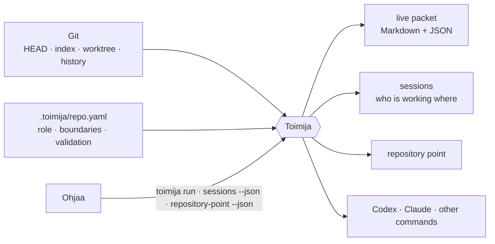
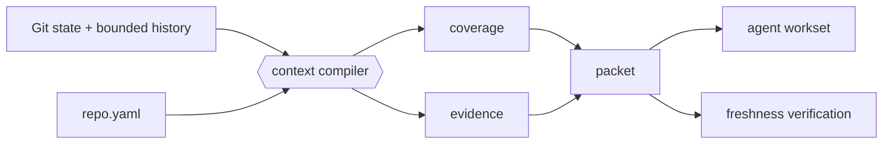

# Toimija

**Git-native facts for coding agents: what is true in this repository, right now.**


*Toimija* is Finnish for “the one who acts.”

> Git knows what repository state exists. Toimija turns that state into a
> bounded, verifiable packet for the agent that acts on it.

**Toimija reports facts and refuses to decide.**

Toimija sits between a repository and a coding harness. It compiles local Git
state into a live context packet, launches Codex, Claude, or another named
command, keeps the packet fresh while the harness runs, and records which
session is working where. At exit it reads the repository again and reports
what the session did.

It answers questions of fact: which repository point is this, what changed,
what should be read first, who else is working here, and does this packet still
describe the live repository. It does not judge work, run checks, or decide
what anyone should do next.

## Where Toimija sits

| Owner | Owns |
| --- | --- |
| **faija** | The ontology: what the words mean |
| **Ohjaa** | Steering Knowledge: decisions, taste and lessons handed to agents |
| **Toimija** | Facts: repository state and points, context packets, sessions, the current work, launching an agent with `toimija run` |
| **Sykli** | Evidence: checks and their receipts |
| **GitHub** | Intent, change, review and merge |



Other tools consume these facts through the CLI and files. Toimija imports no
product and hosts no plugins.

## Why

Coding agents often enter a repository by globbing, grepping, reading, and
guessing. That cold crawl is expensive, repeats across agents, and can reason
from stale state.

> We do not ask the model to understand the repo first. We ask Git what state the repo is in.

Every Git repository already contains a content-addressed database describing
the current branch, HEAD, index, worktree, history, and merge relationships.
Toimija reads that evidence once and produces a bounded packet that answers:

- What repository and branch am I in?
- What changed in commits, the index, and the worktree?
- What should I read first?
- What validation commands does this repository expect?
- Who else is working in this repository, and on what?
- Does this packet still describe the live repository?

Git is not a save button here. Git is the substrate.

> Git gives us the graph of what happened. Toimija turns that graph into operational context for agents.

## Quick start

Build and install Toimija from a checkout:

```bash
git clone https://github.com/false-systems/toimija.git
cd toimija
cargo install --path .
```

**Upgrading.** After installing a new toimija, restart live `toimija run`
sessions. A running `toimija run` keeps the code it started with, and its
watcher keeps writing its session's packets as that version did. Across a
packet schema change (`toimija-context.v2` to `.v3`), the new `verify` refuses
those packets, and a `toimija refresh` holds only until the old watcher's next
change. `verify` says so when it meets one. `toimija --version` names the commit
a binary was built from.

**Upgrading to 0.2.0.** Every build of `main` from June to October 2026 called
itself 0.1.1, so 0.2.0 is the first number that sets a build apart from them.
What breaks:

- Eleven commands are gone: `adopt`, `snippet`, `handoff`, `current`,
  `audit-plan`, `gates`, `plugins`, `verify-work`, `close-work`, `explain-work`
  and `correlate-pr`, with `run --cycle*` and `run --require-work`. Sixteen
  remain; `toimija --help` lists them.
- The packet is `toimija-context.v3`. v2 dropped the `relevance` block, and v3
  renames the top-level `sauma` key to `seal`. `verify` checks the schema
  first, so a v1 or v2 packet is refused before its token is read (exit 1):

  ```
  invalid_packet: the packet is `toimija-context.v2`, which an earlier toimija wrote; this toimija reads `toimija-context.v3`. Run `toimija refresh` to replace it
  ```

  `toimija refresh` replaces it.
- The consistency token is `toimija-consistency-v3` and a repository point's id
  is `rpoint_v3_…`, derived from its tree. Ids and tokens of earlier versions
  are not comparable with these.
- Restart live `toimija run` sessions after installing, as above.

Set it up in a repository:

```bash
cd /path/to/repository
toimija init
toimija run \
  --intent "fix authentication regression" \
  --scope src/auth/ \
  --task "repair the expired-session redirect" \
  -- codex
```

`init` creates `.toimija/repo.yaml` without overwriting an existing file.
Toimija installs nothing else on the repository: the agent docs, hooks and
harness settings stay yours.

`run` then:

1. Discovers the repository and compiles its current Git state.
2. Materializes the exact repository point.
3. Opens a per-session live packet under `.toimija/sessions/<id>/`.
4. Verifies the packet against the live repository and starts the harness
   directly, with no shell in between.
5. Refreshes the packet on relevant repository changes.
6. Reads the repository again after the harness exits and summarizes what the
   session did.

**Outside a repository.** Sometimes an agent has to work from a folder that is
not a Git repository — `~/projects`, say, across several repos. There `run`
opens a session with no packet (there is no Git context to compile): a marker,
a heartbeat, and the `TOIMIJA_RUN`/`TOIMIJA_SESSION` handshake, with the task
in a known agent's launch prompt and a note saying why there is no packet. The
marker lives in the machine-local state directory (`$TOIMIJA_STATE_DIR`, else
`$XDG_STATE_HOME/toimija`, else `~/.local/state/toimija`), never as a
`.toimija/` folder where the agent works, and `toimija sessions
--outside-repos` lists it. Sessions in the repos it touches do not count it as
a sibling, so the agent should declare its scope. `--for-diff` and `--budget`
need a repository and are refused there.

**Alerts.** `--alert <TEXT>` (repeatable, 1024 bytes in total) puts a
launcher's urgent lines first in the launch prompt, above the packet, under
`## Before anything else (from the launcher)`. Long background still goes in
`--briefing`, at the end. `--task`, `--briefing` and `--alert` may start with
`-`, but when the next argument is one of `run`'s own flags, or `--`, the value
was left out: `run` refuses it (exit 2) and launches nothing. Text that is a
flag's name is written `--task=<text>`.

**Idle Codex startup.** Without `--task` (or with a blank task), the built-in
Codex adapter supplies the packet and optional `--briefing` through the
per-session `developer_instructions` configuration instead of a positional
prompt. Codex opens and waits for your first message: no acknowledgement turn
is requested. Codex adds that setting to its own developer instructions
(skills, permissions, collaboration mode), so the slot carries only the packet
and the briefing; a `developer_instructions` set in your own Codex config is
replaced for that session. One you pass yourself (`-c developer_instructions=…`)
is kept: the launch is then not idle, and the packet goes in the first
message, so Codex starts a turn (`run` says so). The first task still has the full context. Explicit `agents.codex` prompt
configuration retains its configured delivery. Subcommands such as `codex exec`
and `codex resume` retain prompt delivery; only interactive launches wait.

Known agents such as `codex`, `claude`, and `gemini` otherwise receive the packet in their
launch prompt. An `agents:` entry in `.toimija/repo.yaml` teaches `run` how
any other CLI accepts it — `prompt: positional`, or a flag such as
`prompt: --message` — so the packet (and `--task`) can be inlined for any
harness without patching toimija. Other commands receive the session paths
through environment variables and are reported honestly as environment-only
delivery.

For Codex, `run` also carries its generated handshake through per-session
`shell_environment_policy.set` overrides. Tool commands may execute in an
already-running Codex daemon, which cannot inherit the terminal wrapper's
environment. This passes only this run's Toimija identity and paths; it does not
change global configuration, environment filtering, or sandbox permissions.
Variables `run` removes from the agent's environment (the retired ones, and
outside a repository the repository paths) are set empty for Codex tools, since
`set` cannot remove a variable the daemon already has; toimija reads an empty
handshake value as unset.
Restart an existing Codex session through the updated wrapper to receive it.

While the harness owns the terminal, toimija seals its own stdout and stderr
onto `.toimija/sessions/<id>/diagnostics.log` at the file-descriptor level
and hands the saved terminal to the wrapped command: watcher output, refresh
warnings, even panic messages land in the log, and the count is summarized
after the command exits.

Use `--` before harness arguments:

```bash
toimija run --intent unknown -- codex --help
```

`--intent` is required; `--intent unknown` is the deliberate escape hatch.

## Repository points

A repository point names one exact state of the repository: the worktree
materialized as a Git tree, with Toimija's content-based consistency token
beside it.

```bash
toimija -q repository-point --json
```

The output is a
[`false-agent-protocol`](https://github.com/false-systems/false-agent-protocol)
v1 `RepositoryPointEnvelope`: repository ref, point ref, tree OID, consistency
token, branch, and dirty flag. `extensions.tree_algorithm` names the tree's
algorithm and `extensions.consistency_algorithm` the token's version. Inside a
`run` session the same point is available at
`$FALSE_SYSTEMS_REPOSITORY_POINT_PATH`, and the sealed session packet carries it
as `session.execution.repository`.

The tree is faija's **tree-identity.v1**, the identity of a working State:
every tracked and untracked non-ignored path, without the generated namespaces
`.toimija/`, `.teko/` and `.sykli/`, with `.toimija/repo.yaml` forced in even
when ignored. Toimija runs faija's canonical procedure from a vendored copy of
`faija-terms` (`vendor/faija-terms.contract`) and keeps no tree algorithm of its
own. An envelope or snapshot lease that does not name the algorithm was written
before, and its tree is the legacy one (`toimija-legacy`), never reinterpreted.

### What a point guarantees

**Equal points mean equal trees, by construction.** The point id is
`rpoint_v3_` followed by the SHA-256 of six fields, each ended by a NUL byte:
the marker `rpoint_v3_`, the repository ref, the token's version, the token, the
tree's algorithm, and the tree. Two points with one id hold one tree, whatever
the token did or did not see. The reverse does not hold: two points can share a
tree and differ in HEAD, the index or the branch. Deriving the id costs no git
process, because the point writes its tree anyway.

**The token is a freshness check, not an identity.** It fingerprints, by
content, what `git status` lists: HEAD, the index, the worktree, untracked
files, conflicts and in-progress operations. It is what `verify` compares.
Equal tokens do not mean equal trees. The token leaves out exactly what
tree-identity.v1 leaves out (`.toimija/`, `.teko/` and `.sykli/`, but not
`.toimija/repo.yaml`), so a gate writing receipts into a `.sykli/` that git can
see moves neither the tree nor the token.

The token is read again after the tree is written (one `git status`). If it
moved, the point is read afresh, after a short pause, up to three times in all,
and then refused. A move the token observes is never paired across.

`dirty: false` means `git status` reported nothing outside the generated
namespaces the token leaves out, so a receipt in `.sykli/` leaves a state
clean on every machine, whatever its global ignore file hides; the packet's
file lists still show everything `git status` reported. It does not mean the
tree equals `HEAD^{tree}`. Several of the cases below print `dirty: false`
with a tree that differs from HEAD's.

### Known gaps

Each of these changes the tree and not the token (issue #239;
`tests/cli_point_identity.rs` has one test per row). For **point identity**,
each is closed by construction: the state before and the state after get two
point ids. For **freshness**, each remains a blind spot of the token: after the
change, `verify` still passes the packet, and a held point still looks current.

| # | Change | Point ids | Token |
| --- | --- | --- | --- |
| 1 | Edit an ignored, untracked `.toimija/repo.yaml`, which the tree forces in | differ | blind |
| 1b | Create that file | differ | blind |
| 2 | Commit again inside a submodule that is already ahead; the token sees a gitlink as a directory | differ | blind |
| 3 | Commit inside a nested, untracked repository | differ | blind |
| 4 | Edit a file marked `assume-unchanged` | differ | blind |
| 5 | Edit a file marked `skip-worktree` | differ | blind |
| 6 | A same-size edit with the mtime put back, under `core.checkStat=minimal` and `core.trustctime=false` | differ | blind |
| 7 | One commit in a sparse and in a full checkout; the sparse tree keeps namespace content outside the cone | differ | blind |
| A→B→A | A change made and undone while the tree is written | the point names the tree it wrote (B), and its id is not the settled point's (A) | blind: the re-read sees A, so the B point looks current |

Three edge cases belong to tree-identity.v1 itself, and are raised with faija
(KATANA, Stage 8): an ignored `.toimija/repo.yaml` outside a sparse cone and a
symlinked `.toimija/` both make the tree write fail, and "non-ignored" depends
on each machine's global ignore file, so one content can have two v1 trees on
two machines.

### Versions

Points and tokens carry their version. The token is `toimija-consistency-v3`
(KATANA D9), and point ids begin `rpoint_v3_`. Earlier ids (`rpoint_` and 64
hex digits, derived from the repository and the token alone) and earlier tokens
(`toimija-consistency-v2` and `-v1`) keep the meaning they were written with.
They are never recomputed or relabelled, and a comparison across versions says
**not comparable**, never "equal" or "different":

- `verify` checks a packet's schema before its token, so a packet from an
  earlier toimija (`toimija-context.v1` or `.v2`) is `invalid_packet`, never
  `not_comparable`; `toimija refresh` replaces it. Only a current-schema packet
  carrying an earlier token reaches `not_comparable`;
- snapshot leases name their token's version (`token_algorithm`). One
  written earlier names none, and none is claimed for it.

The token keeps its `sha256:<hex>` shape, which the seal's envelope format
requires of an anchor. Its hash covers the version name, so tokens of two
versions never coincide.

## The live packet

The delivered packet replaces repository discovery: use its Git facts, Read
first list and validation plan directly, then read the named files for unresolved
task details. Refresh when those facts become stale or contradictory. A session
outside a repository with no concrete task waits for work; it does not spend
model calls on startup-only discovery or bookkeeping. Scope is still declared
before repository work, and verification before commit or handoff still applies.

Toimija writes human-readable Markdown and complete machine-readable JSON
(schema `toimija-context.v3`; docs/reference.md, "Packet compatibility"):

```text
.toimija/current.md
.toimija/current.json
.toimija/sessions/<id>/current.md
.toimija/sessions/<id>/current.json
```

The per-session packet is authoritative for a wrapped harness. The repo-level
pair is a last-writer-wins summary for sessionless readers. It carries a
session's block (id, intent, scope) only while that session runs: when `run`
exits, the repo-level pair is rewritten without it, and `toimija verify` fails
(`session_not_live`) on any packet that briefs a session that has closed or
whose process is gone.

A packet combines:

- branch, HEAD, upstream, ahead/behind (against the upstream, else
  `origin/<default>`, or the one remote's default when none is named `origin`;
  from local refs only, and not counted in a shallow repository), merge-base,
  and recent commits;
- staged, unstaged, untracked, renamed, and conflicted paths;
- unsafe Git operation state;
- the committed branch surface;
- what to read first: the repository's configured and important docs, always
  and first, then the changed files and their companion tests (by path, not by
  mining history) up to the list's cap;
- collection coverage: `available`, `degraded`, or `failed`;
- repository boundaries, exclusions, and validation plans;
- session identity, entry baseline, declared intent, scope, and the session's
  repository point;
- a content-based Git consistency token (a freshness check, versioned in
  `consistency.algorithm`) and a refresh token over the collected Git state;
- a seal: the digest of the packet's canonical form, its provenance edges and
  its producer, under the key `seal`.

Every packet carries a workset contract:

> Work from the changed surface and Read first. Treat configured exclusions as
> do-not-scan. If a concrete dependency requires reading outside the workset,
> declare that expansion first. Expansion is never forbidden; invisible
> expansion is.

Markdown is budgeted for agents; optional sections are omitted atomically and
reported by name. JSON remains complete. Safety state, warnings, exclusions,
and the workset contract are never silently clipped.

Before commit or handoff:

```bash
toimija verify
```

`verify` recomputes live Git state and checks the packet's content-based token.
Among the paths `git status` lists, same-size edits, index changes, conflicts,
and unsafe Git operations cannot hide behind timestamps; what `git status` does
not list, the token does not see ("Repository points", "Known gaps"). A packet
whose token is of an earlier version is `not_comparable`, never fresh or stale;
refresh it. A packet's seal must be a `sauma-envelope.v2` (the name the
envelope format keeps from the archived sauma, whose sealing code Toimija now
carries as its own); any other is refused rather than read as a body-only seal,
and a packet with no seal is refused. The seal's schema and anchor must match
the packet schema and consistency token. A packet an earlier toimija wrote
(`toimija-context.v2`, whose seal sat under `sauma`) is refused with the way
out: `toimija refresh` replaces it.

## Sessions and collaboration

Each `toimija run` creates a separate session directory, so concurrent agents do
not race on one shared packet.

```bash
toimija sessions
toimija sessions --json
toimija sessions --outside-repos   # sessions `run` opened outside any repository
```

The session listing reports live, stale, and closed sessions plus descriptive
overlap warnings for branch, worktree, intent, and scope. These are awareness
signals, not locks or assignments. JSON also exposes `pid_check` (`alive`,
`dead`, or `unknown`), the process probe separately from heartbeat age. A
`stale` session with a `dead` PID is no longer running under that PID; a
`stale` session with an `alive` or `unknown` PID is still uncertain. The marker
records when its process started (`pid_start`, Linux and macOS), so a PID handed
on to another process reads `dead`. On other systems, and for markers written
without it, PID reuse can keep an obsolete session uncertain. Listing never
rewrites markers.
Outside a repository, `toimija sessions` lists the sessions opened outside
any repository, and says so.

A wrapped agent can update its own declaration:

```bash
toimija intent "repairing token refresh" --scope src/auth/
```

Closed sessions are summarized in `.toimija/history.jsonl`. Stewardship remains
explicit and bounded:

```bash
toimija clean --dry-run
toimija clean
```

The sweep never follows a symlink: if `.toimija`, `.toimija/sessions`, or
`.toimija/runs` is not a real directory it refuses, and nothing is deleted
unless it resolves inside the repository's own `.toimija/`. The commands that
write there refuse a symlinked `.toimija` the same way.

Toimija does not assign tasks, choose priorities, or decide which agent should
work. GitHub issues, pull requests, labels, and the human remain the coordination
layer.

## Trust and security

Snapshot listings shorten tree identifiers at character boundaries, so a
damaged local marker containing non-ASCII text cannot crash the listing.
Displaying a marker does not validate its claimed tree identifier.

The runtime boundary is intentionally narrow:

- no product imports, plugins, or dynamic libraries;
- no repository-controlled executable paths: `agents:` describes how a prompt
  is delivered, and the harness is always the command named after `--`;
- no shell interpolation: `run` executes the named command with its arguments
  directly;
- no hidden daemon or background service;
- no network access of its own;
- nothing is written, appended, or deleted through a symlink out of the
  repository: a symlinked `.toimija`, or directory under it, is refused loudly;
- snapshot lease ids are names, never paths.

Toimija invokes harnesses only during an explicitly requested foreground
command.

## Git-native context

Toimija's job is turning Git plumbing into agent-facing porcelain.



Toimija does not maintain a second repository index. Snapshots use Git tree
objects; Read first uses existence-checked paths; freshness uses content-derived
tokens. When evidence is missing, the packet says so instead of converting
failure into an empty, reassuring list.

## Commands

| Command | Purpose |
| --- | --- |
| `run --intent "..." -- <harness>` | Compose context, launch a harness, refresh, and summarize |
| `repository-point` | Export the exact current repository point |
| `enter`, `context`, `refresh`, `watch` | Produce or maintain a live packet |
| `verify`, `snapshot` | Verify freshness or materialize an immutable Git tree |
| `sessions`, `intent`, `history` | Observe and record local session continuity |
| `clean` | Reclaim expired Toimija-owned artifacts |
| `validate --plan` | Render validation commands without executing them |
| `landed` | Check whether branch content reached a base ref |
| `init`, `doctor` | Configure a repository and detect setup drift |

Every command finds its worktree with one `git rev-parse` and reads
`git status` once, and reads nothing its output does not show:
`tests/cli_budgets.rs` pins how many git processes each starts. A tool that
needs only what a repository says it is reads `toimija context --identity
--json`: the packet's `repo` object, for one git process.

`watch` and `run` keep that discovery, then check the Git files' metadata
(HEAD, index, refs, config) every 500 ms with `stat` alone. While the refs hold
still, a refresh reads one `git status` and carries the rest of the last read. Work-tree edits
arrive as filesystem events — FSEvents on macOS, inotify on Linux — so an idle
tick starts no git process. When the native watcher cannot arm, macOS falls
back to notify polling and Linux to one `git status` per tick, never a
recursive scan of the tree. Once a minute a safety net compares one
`git status` with the packet, so a missed event does not leave a live packet
stale for long.

Use `toimija <command> --help` for flags and examples. The
[complete reference](docs/reference.md) documents packet fields, environment
variables, configuration, output guarantees, and every command.

## Repository configuration

`.toimija/repo.yaml` gives durable meaning to live Git state:

```yaml
repo:
  name: example
  role: service that processes customer events
  not:
    - deployment controller

context:
  default_budget: 8000
  important_docs:
    - README.md
    - AGENTS.md
  read_first: []
  safe_to_ignore:
    - target/

validation:
  replace_inferred: false
  fast:
    - cargo test
  strict:
    - cargo fmt --check
    - cargo clippy --all-targets -- -D warnings
  full:
    - cargo test --workspace
  privileged: []

# Teach `run` how other agent CLIs accept the composed launch prompt
# (`positional`, or a flag). Names resolve by basename; configuration never
# supplies executable paths — the harness is always named after `--`.
agents:
  # aider:
  #   prompt: --message

boundaries:
  - Do not add network calls.
```

Older files may still carry `composition:`, `gates:`, or `gate_groups:`. They
load; Toimija ignores those sections.

`toimija doctor --strict` checks that repository boundaries and major
documentation remain aligned.

## Language and validation support

Rust and Elixir have full adapters. Go, Python, JavaScript/TypeScript and
Terraform receive the minimum language pack: repository detection,
evidence-backed validation hints, and companion-test discovery. Other
repositories work through explicit `.toimija/repo.yaml` configuration.

Adapters contribute planning hints; they do not parse source code. `toimija
validate --plan` prints commands and provenance but never executes them.
Running checks and keeping their receipts is Evidence, and Evidence is Sykli's.

A repository with a `sykli.json` at its root has declared its gate, so the plan
is that gate, exactly — `mkdir -p .sykli && sykli run sykli.json --json >
.sykli/receipt.json && sykli verify .sykli/receipt.json --contract sykli.json` —
with the task names the contract declares (`source: sykli.json`). Nothing is
inferred beside it. Commands in `.toimija/repo.yaml` add to it, and
`replace_inferred: true` drops inferred commands but keeps the gate. Only
`validation.gate` changes the gate: `gate: false` names none, and a string
names that command instead (for example `mise exec -- sykli …`); a blank string
is refused when the config loads. Only the standard gate is said to write
`.sykli/receipt.json`: what a command of your own writes is not toimija's to say.

## Boundaries

Toimija reports facts and refuses to decide. It intentionally does not:

- run validation, gates, or checks, or mint receipts;
- judge, close, assign, or dispatch work;
- make model-provider calls;
- apply patches or commit changes;
- fetch repository data from the network;
- run a daemon after the invoked command exits;
- load plugins or product code;
- build an MCP, LSP, SCIP, Kythe, or Tree-sitter index;
- persist a semantic graph.

Read first remains file-level, path-derived, and advisory. Coverage says
what Toimija successfully observed, not what it knows with certainty.

## Development

Toimija is one Rust crate. The development-only `xtask` installs the
pre-commit hook but is excluded from ordinary root builds.

```bash
git clone https://github.com/false-systems/toimija.git
cd toimija
cargo build
cargo run -- context
```

Before claiming completion:

```bash
cargo fmt --check
cargo clippy --all-targets -- -D warnings
cargo test
```

Install the pre-commit hook once per clone:

```bash
cargo xtask install-pre-commit-hook
```

Release artifacts are built by GitHub Actions for `v*` tags. The public
`false-agent-protocol` dependency is fetched over HTTPS, so a fresh checkout
requires no sibling repository or private Git credentials.

## Declared work graph

The same gate is this repository's [sykli](https://github.com/false-systems/sykli)
contract: `sykli.json` (`sykli-contract.v1`), pinned by `sykli.lock`, run
with `sykli run` and by the advisory `Sykli` CI job. Receipts are
content-addressed, so a task whose inputs have not changed is a cache hit.
Sykli here is CI only; Sykli delegation inside toimija's commands stays out of
scope (`.toimija/repo.yaml`).

| task | runs | after | reads |
| --- | --- | --- | --- |
| `fmt` | `cargo fmt --check` | | every `.rs` and `Cargo.toml` |
| `clippy` | `cargo clippy --all-targets -- -D warnings` | `fmt` | the code: `.rs`, `Cargo.toml`, `Cargo.lock`, `rust-toolchain.toml`, `.cargo/` |
| `test` | `cargo test` | `fmt` | every tracked file |
| `doctor` | `cargo run --quiet -- doctor --strict` | `test` | every tracked file |

`fmt`, `clippy` and `test` are the three checks AGENTS.md asks for before
claiming completion. `test` and the drift guard read far more than code
(fixtures, the agent docs, `repo.yaml`, this README), so they declare every
tracked file except the contract and its lock; an undeclared input would be
served from cache. `doctor` dogfoods the drift guard after `test`, when the
debug binary is already built.

Inputs are exact paths, not globs. A new tracked file goes into `test` and
`doctor` (and into `fmt` and `clippy` if it is code) by hand; then
`git add -A && sykli lock` re-pins the contract, which must be staged because
the inputs come from Git. `sykli run` refuses to start while a tracked `.rs`,
Cargo manifest or lockfile, `rust-toolchain*`, `.cargo/config*` or file under
`tests/` is in no task's inputs, and `sykli plan --explain` warns about any
other changed file that no task declares.

## Documentation

- [Complete command and packet reference](docs/reference.md)
- [Design proposals](docs/proposals/)
- [Audit history](docs/audit/)
