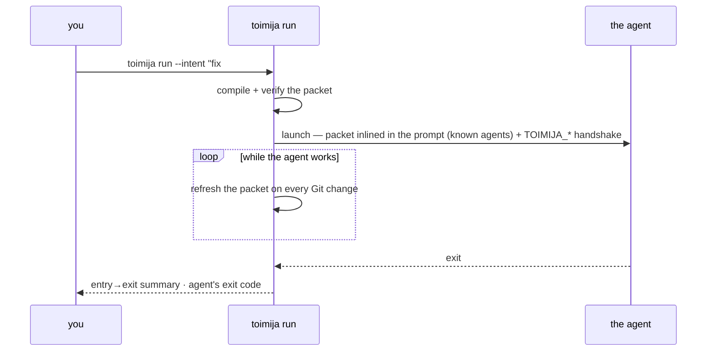

# Toimija

**The live entrance for agents into a repo. Simple, fast, smart.**


*Toimija* is Finnish for "the one who acts."

> We do not ask the model to understand the repo first. We ask Git what state the repo is in.

Every coding agent enters a repo the same way: glob, grep, read, guess. That
cold crawl is slow, costs tokens, and is wrong the moment the repo moves. But
every repo already ships a database that knows exactly what is going on — Git.
Toimija compiles it into one small live packet, puts that packet in the
agent's face, and tells you afterwards whether it was used.

Git is not a save button here. Git is the substrate.

## 30 seconds

```bash
cargo install --path .
cd /path/to/repo
toimija init                              # once: seed .toimija/repo.yaml
toimija adopt --hooks                     # once: agents learn to read the packet
toimija run --intent "fix #51" -- codex   # every time: wrap the agent
```

That is the whole workflow. `run` compiles the packet, verifies it against
live Git state, launches the agent **with the packet inlined in its launch
prompt** (`claude`, `codex`, `gemini`), keeps it fresh on every Git change while the
agent works, and exits with the agent's status plus an honest report: what
changed, and what of toimija the session actually used.



Use `--` before the wrapped command when you need to pass flags through
unambiguously, for example `toimija run --intent unknown -- codex --help`.

Each `run` opens a **session** with its own live packet under
`.toimija/sessions/<id>/`, so concurrent wrapped agents do not race on a single
shared file. While the agent works, that session packet stays fresh: every
relevant filesystem or Git-state change re-runs the refresh after a short
debounce. The watcher uses a bounded 500 ms polling scan and therefore adds
roughly 500 ms plus debounce latency, with full-tree stat cost while `watch` or
`run` is active. It is foreground-only and stops the moment the agent exits —
no daemon survives the command. The repo-level `.toimija/current.*` is kept too,
demoted to a last-writer-wins "latest" summary for sessionless readers.

The polling backend is the boring reliability baseline: a future optimization
can restore native events with a polling catch-up tick once measurements prove
the safety margin.

So the wrapped agent can *find* its live packet, `run` hands it an environment
handshake. For known agents this is the backup channel (the packet already
travels in the launch prompt); for everything else it is the only signal `run`
injects into the child:

| Variable | Meaning |
| --- | --- |
| `TOIMIJA_RUN=1` | The agent is under `run`; a watcher is keeping the packet fresh. |
| `TOIMIJA_SESSION` | This session's id (`<unix-secs>-<pid>`). `toimija intent`, `enter`, and `refresh` use it to find the session. |
| `TOIMIJA_LIVE` | Absolute path to this session's live `current.md` (authoritative). |
| `TOIMIJA_LIVE_JSON` | Absolute path to this session's live `current.json`. |
| `TOIMIJA_CURRENT_MD` | Alias of `TOIMIJA_LIVE`, for harnesses that key on the file name. |
| `TOIMIJA_CURRENT_JSON` | Alias of `TOIMIJA_LIVE_JSON`. |
| `TOIMIJA_REPO_ROOT` | Absolute path of the repo root the session runs in. |
| `TOIMIJA_RUN_ID` | Alias of `TOIMIJA_SESSION`. |
| `TOIMIJA_REPO_LIVE` | Absolute path to the repo-level `current.md` summary. |

An agent that honors the handshake re-reads `$TOIMIJA_LIVE` after Git-state
changes instead of re-running `enter`. `toimija snippet preflight` already tells
agents to do this.

Each session also writes a `.toimija/sessions/<id>/session.json` marker (id, pid,
agent argv, worktree, branch, HEAD, intent, scope, timestamps, status) that `run`
auto-closes on exit. The marker is what `toimija sessions` reads (below) and the
foundation for the `toimija handoff` record designed in
`docs/proposals/0001-sessions-awareness-handoff.md`.

## Multi-agent sessions

Several agents can work one repo at once without trampling each other's context.
Each wrapped agent gets its **own** session packet, and `toimija sessions` makes
the others visible.

Declare why you're here (and optionally what you'll touch) when you launch — it's
advisory, never an assignment or a lock:

```bash
toimija run --intent "add sessions command" --scope src/sessions.rs -- codex
```

The wrapped agent can also speak for itself, mid-session — it finds its own
marker through the `TOIMIJA_SESSION` handshake:

```bash
toimija intent "migrating the auth module" --scope src/auth/
```

## The magic

One idea, applied everywhere: **git is the database.** Every repo already
ships a battle-tested, content-addressed, distributed database that every
machine knows how to replicate — `.git`. Toimija refuses to build a second
one. It is a git porcelain whose client is an agent instead of a human:

- **Context** is compiled from plumbing reads — no index to keep fresh, no
  daemon, nothing to go stale. Fast because there is nothing to warm up.
- **Budgets** never cut a path or hide safety state: optional sections are
  omitted whole with exact counts, while the companion JSON stays complete.
- **Freshness** is a content-based consistency token in every packet;
  `toimija verify` proves the packet still matches the repo before anyone
  trusts it. The packet is a claim, not a hope.
- **Snapshots** are `write-tree` plus a ref — an immutable version of the
  worktree, garbage-collected by git itself.
- **Provenance** is a canonical digest plus edges (the sauma envelope) —
  passive files and a reader, the same shape as git.

The design test for any new need: *"does git already store this?"* — before
writing a line of infrastructure.

> Git gives us the graph of what happened. Toimija turns that graph into operational context for agents.

## Wrapped means used

Toimija does not hope agents read its context — it removes the choice:

- Every packet opens with a **workset contract**: work from the Git-derived
  Compiled workset and Read order; the session's declared scope remains
  advisory intent. Exclusions are do-not-scan; declare any expansion. *Expansion is
  never forbidden; invisible expansion is.*
- `run` **refuses to launch without `--intent`** — declaring why the session
  exists is the entry fee (`--intent unknown` is the escape hatch).
- Known agents get the packet **in their launch prompt** — argv, not an env
  var they might check. They cannot not-see it. Your `--task` travels with it.
- The exit summary reports **consumption**: intent, declared expansions,
  handoff records. Non-use is visible, never silent.
- `toimija adopt` maintains one flat instruction — read the packet first —
  in every agent entry file convention (`AGENTS.md`, `CLAUDE.md`,
  `.cursorrules`, …), drift-guarded by `doctor --strict`; `--hooks` adds Git
  refresh hooks and the repo-local Claude Code SessionStart hook.

```text
toimija run: session summary
  branch:    main → feature/login
  HEAD:      a1b2c3d → e4f5a6b (moved)
  refreshed: 12 time(s) while you worked
  intent:    "add login flow" (declared at launch)
  expansions: 2 scope path(s) declared while working
  handoff:   1 record(s)
```

## Many agents, one repo

Each wrapped agent gets its own live session packet — no trampling.
`toimija sessions` shows who else is live (heartbeat-based, read-only),
`toimija intent` lets an agent declare what it is doing mid-session, and
`toimija handoff` leaves a versioned record for whoever continues the work.
Visibility, never orchestration: toimija never assigns, blocks, or kills —
the human stays the orchestrator.

## What you get

| | |
|---|---|
| **A live work packet** | Branch, HEAD, merge-base, changed surface, warnings — refreshed while the agent works. |
| **Git-derived relevance** | What to read first, what co-changes, what is risky. Advisory, no source parsing. |
| **Verifiable freshness** | A content-based token in every packet; `verify` before trust; `snapshot` to freeze. |
| **Multi-agent awareness** | Sessions, overlap warnings, handoff records. |
| **Chain of custody** | Sauma envelopes link artifacts across tools to the exact repo state they came from. |
| **Validation plans** | Inferred per language, overridden by config, never executed by toimija. |
| **Staged audits** | `audit-plan` cuts a repo into bounded, deterministic audit surfaces. |
| **Squash-proof landing checks** | `landed` answers "did this branch land?" by content, where ancestry lies. |

Languages: **Rust** and **Elixir** have full adapters; **Go, Python, JS/TS**
get the minimum language pack (detection, test + lint plan, companion-test
hints — one data row each); anything else works via `repo.yaml` config.

## Commands

```bash
toimija run --intent "..." [--task "..."] -- <agent>   # the entrypoint
toimija sessions | intent | handoff        # awareness · declaration · handoff
toimija enter | context | refresh | watch  # the packet, on demand
toimija verify | snapshot                  # trust, then freeze
toimija audit-plan [--surface K]           # bounded audit worksets
toimija adopt [--hooks] | init | doctor    # setup and the drift guard
toimija validate --plan | landed           # validation plan · landing check
```

Every command, flag, and output guarantee: **[docs/reference.md](docs/reference.md)**.

## Boundaries

The boundaries are the feature. No network, ever. No daemons — `watch`/`run`
live only while invoked. No source parsing, no MCP/LSP/Tree-sitter. No
mid-session policing: delivery is structural at launch, evidence at exit,
nothing in between. Advisory posture throughout; the one opt-in gate is
`doctor --strict`, which fails CI when config and agent docs drift apart.

## Develop

```bash
cargo build && cargo test
cargo xtask install-pre-commit-hook   # once per clone: fmt + clippy + test gate
```

Full manual: **[docs/reference.md](docs/reference.md)** · design history:
`docs/proposals/`
