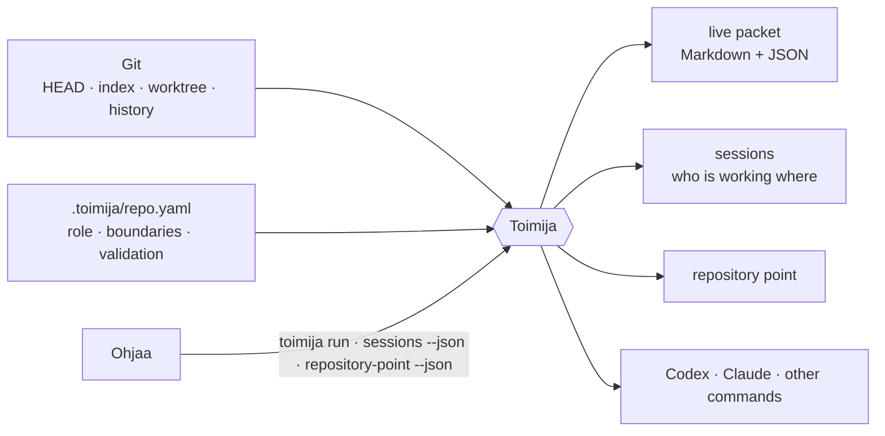
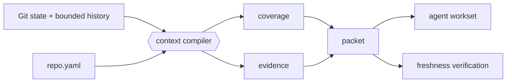

# Toimija

**Git-native facts for coding agents: what is true in this repository, right now.**


*Toimija* is Finnish for “the one who acts.”

> Git knows what repository state exists. Toimija turns that state into a
> bounded, verifiable packet for the agent that acts on it.

**Toimija reports facts and refuses to decide.**

Toimija sits between a repository and a coding harness. It compiles local Git
state into a live context packet, launches Codex, Claude, or another named
command, keeps the packet fresh while the harness runs, and records which
session is working where. At exit it reads the repository again and reports
what the session did.

It answers questions of fact: which repository point is this, what changed,
what should be read first, who else is working here, and does this packet still
describe the live repository. It does not judge work, run checks, or decide
what anyone should do next.

## Where Toimija sits

| Owner | Owns |
| --- | --- |
| **faija** | The ontology: what the words mean |
| **Ohjaa** | Steering Knowledge: decisions, taste and lessons handed to agents |
| **Toimija** | Facts: repository state and points, context packets, sessions, the current work, launching an agent with `toimija run` |
| **Sykli** | Evidence: checks and their receipts |
| **GitHub** | Intent, change, review and merge |



Other tools consume these facts through the CLI and files. Toimija imports no
product and hosts no plugins.

## Why

Coding agents often enter a repository by globbing, grepping, reading, and
guessing. That cold crawl is expensive, repeats across agents, and can reason
from stale state.

> We do not ask the model to understand the repo first. We ask Git what state the repo is in.

Every Git repository already contains a content-addressed database describing
the current branch, HEAD, index, worktree, history, and merge relationships.
Toimija reads that evidence once and produces a bounded packet that answers:

- What repository and branch am I in?
- What changed in commits, the index, and the worktree?
- What should I read first?
- Which files tend to change together?
- Which areas are risky or high-churn?
- What validation commands does this repository expect?
- Who else is working in this repository, and on what?
- Does this packet still describe the live repository?

Git is not a save button here. Git is the substrate.

> Git gives us the graph of what happened. Toimija turns that graph into operational context for agents.

## Quick start

Build and install Toimija from a checkout:

```bash
git clone https://github.com/false-systems/toimija.git
cd toimija
cargo install --path .
```

Adopt it in a repository:

```bash
cd /path/to/repository
toimija init
toimija adopt --hooks
toimija run \
  --intent "fix authentication regression" \
  --scope src/auth/ \
  --task "repair the expired-session redirect" \
  -- codex
```

`init` creates `.toimija/repo.yaml` without overwriting an existing file.
`adopt --hooks` installs the small “read the live packet first” preamble in
recognized agent instruction files and adds best-effort Git refresh hooks.

`run` then:

1. Discovers the repository and compiles its current Git state.
2. Materializes the exact repository point.
3. Opens a per-session live packet under `.toimija/sessions/<id>/`.
4. Verifies the packet against the live repository and starts the harness
   directly, with no shell in between.
5. Refreshes the packet on relevant repository changes.
6. Reads the repository again after the harness exits and summarizes what the
   session did.

**Outside a repository.** Sometimes an agent has to work from a folder that is
not a Git repository — `~/projects`, say, across several repos. There `run`
opens a session with no packet (there is no Git context to compile): a marker,
a heartbeat, and the `TOIMIJA_RUN`/`TOIMIJA_SESSION` handshake, with the task
in a known agent's launch prompt and a note saying why there is no packet. The
marker lives in the machine-local state directory (`$TOIMIJA_STATE_DIR`, else
`$XDG_STATE_HOME/toimija`, else `~/.local/state/toimija`), never as a
`.toimija/` folder where the agent works, and `toimija sessions
--outside-repos` lists it. Sessions in the repos it touches do not count it as
a sibling, so the agent should declare its scope. A cycle leg, `--for-diff`,
and `--budget` need a repository and are refused there.

**Idle Codex startup.** Without `--task` (or with a blank task), the built-in
Codex adapter supplies the packet and optional `--briefing` through the
per-session `developer_instructions` configuration instead of a positional
prompt. Codex opens and waits for your first message: no acknowledgement turn
is requested. Before using that override, Toimija runs Codex's local
`debug prompt-input` renderer with the same launch options and preserves its
existing developer block, including permission guidance and configured
instructions. No model is called to do this; an unreadable renderer fails the
launch rather than dropping instructions. The first task still has the full
context. Explicit `agents.codex` prompt
configuration retains its configured delivery. Subcommands such as `codex exec`
and `codex resume` retain prompt delivery; only interactive launches wait.

Known agents such as `codex`, `claude`, and `gemini` otherwise receive the packet in their
launch prompt. An `agents:` entry in `.toimija/repo.yaml` teaches `run` how
any other CLI accepts it — `prompt: positional`, or a flag such as
`prompt: --message` — so the packet (and `--task`) can be inlined for any
harness without patching toimija. Other commands receive the session paths
through environment variables and are reported honestly as environment-only
delivery.

For Codex, `run` also carries its generated handshake through per-session
`shell_environment_policy.set` overrides. Tool commands may execute in an
already-running Codex daemon, which cannot inherit the terminal wrapper's
environment. This passes only this run's Toimija identity and paths; it does not
change global configuration, environment filtering, or sandbox permissions.
Restart an existing Codex session through the updated wrapper to receive it.

While the harness owns the terminal, toimija seals its own stdout and stderr
onto `.toimija/sessions/<id>/diagnostics.log` at the file-descriptor level
and hands the saved terminal to the wrapped command: watcher output, refresh
warnings, even panic messages land in the log, and the count is summarized
after the command exits.

Use `--` before harness arguments:

```bash
toimija run --intent unknown -- codex --help
```

`--intent` is required; `--intent unknown` is the deliberate escape hatch.

## Repository points

A repository point names one exact state of the repository: the worktree
materialized as a Git tree, paired with Toimija's content-based consistency
token.

```bash
toimija -q repository-point --json
```

The output is a
[`false-agent-protocol`](https://github.com/false-systems/false-agent-protocol)
v1 `RepositoryPointEnvelope`: repository ref, point ref, tree OID, consistency
token, branch, and dirty flag. Inside a `run` session the same point is
available at `$FALSE_SYSTEMS_REPOSITORY_POINT_PATH`, and the sealed session
packet carries it as `session.execution.repository`.

## The live packet

The delivered packet replaces repository discovery: use its Git facts, read
order and validation plan directly, then read the named files for unresolved
task details. Refresh when those facts become stale or contradictory. A session
outside a repository with no concrete task waits for work; it does not spend
model calls on startup-only discovery or bookkeeping. Scope is still declared
before repository work, and verification before commit or handoff still applies.

Toimija writes human-readable Markdown and complete machine-readable JSON:

```text
.toimija/current.md
.toimija/current.json
.toimija/sessions/<id>/current.md
.toimija/sessions/<id>/current.json
```

The per-session packet is authoritative for a wrapped harness. The repo-level
pair is a last-writer-wins summary for sessionless readers.

A packet combines:

- branch, HEAD, upstream, merge-base, and recent commits;
- staged, unstaged, untracked, renamed, and conflicted paths;
- unsafe Git operation state;
- the committed branch surface;
- a Git-derived workset and ordered reading plan;
- coupling and risk hints with evidence and confidence;
- collection coverage: `available`, `degraded`, or `failed`;
- repository boundaries, exclusions, and validation plans;
- session identity, entry baseline, declared intent, scope, and the session's
  repository point;
- a content-based Git consistency token and a refresh token over the collected
  Git state;
- a Sauma provenance envelope.

Every packet carries a workset contract:

> Work from the compiled workset and read order. Treat configured exclusions as
> do-not-scan. If a concrete dependency requires reading outside the workset,
> declare that expansion first. Expansion is never forbidden; invisible
> expansion is.

Markdown is budgeted for agents; optional sections are omitted atomically and
reported by name. JSON remains complete. Safety state, warnings, exclusions,
and the workset contract are never silently clipped.

Before commit or handoff:

```bash
toimija verify
```

`verify` recomputes live Git state and checks the packet's content-based token.
Same-size edits, index changes, conflicts, and unsafe Git operations cannot hide
behind timestamps. Sauma envelopes must be v1 or v2; unknown versions are
rejected instead of being interpreted as legacy body-only seals, and packets
with no envelope are refused. The envelope schema and anchor must match the
packet schema and consistency token.

## Sessions and collaboration

Each `toimija run` creates a separate session directory, so concurrent agents do
not race on one shared packet.

```bash
toimija sessions
toimija sessions --json
toimija sessions --outside-repos   # sessions `run` opened outside any repository
```

The session listing reports live, stale, and closed sessions plus descriptive
overlap warnings for branch, worktree, intent, and scope. These are awareness
signals, not locks or assignments. JSON also exposes `pid_check` (`alive`,
`dead`, or `unknown`), the process probe separately from heartbeat age. A
`stale` session with a `dead` PID is no longer running under that PID; a
`stale` session with an `alive` or `unknown` PID is still uncertain. PID reuse
can keep an obsolete session uncertain. Listing never rewrites markers.
Outside a repository, `toimija sessions` lists the sessions opened outside
any repository, and says so.

A wrapped agent can update its own declaration:

```bash
toimija intent "repairing token refresh" --scope src/auth/
```

It can leave a durable continuation record:

```bash
toimija handoff "redirect fixed; rerun the integration tests"
toimija handoff --show <session-id>
```

Every closed session also records the **effects** it had outside the working
tree, detected after the fact from Git and `gh`: `commit` when HEAD moved,
`push` when the branch's upstream ref moved to something HEAD contains,
`open_pr` when a pull request for the branch appeared. `toimija sessions --json`
exposes them as `effects_observed`, with `effects_coverage` set to `partial`
whenever an inspection could not run (no `gh`, no answer within its deadline,
git unavailable) — so an effect that was not seen is never read as an effect
that did not happen. Consumers such as Ohjaa compare this list with what a
cycle declared. This is detection, not prevention; preventing an undeclared
push is a sandbox's job (Rauha), not a Git observer's.

Closed sessions are summarized in `.toimija/history.jsonl`. Stewardship remains
explicit and bounded:

```bash
toimija clean --dry-run
toimija clean
```

The sweep never follows a symlink: if `.toimija`, `.toimija/sessions`, or
`.toimija/runs` is not a real directory it refuses, and nothing is deleted
unless it resolves inside the repository's own `.toimija/`. The commands that
write there refuse a symlinked `.toimija` the same way.

Toimija does not assign tasks, choose priorities, or decide which agent should
work. GitHub issues, pull requests, labels, and the human remain the coordination
layer.

## Trust and security

The runtime boundary is intentionally narrow:

- no product imports, plugins, or dynamic libraries;
- no repository-controlled executable paths: `agents:` describes how a prompt
  is delivered, and the harness is always the command named after `--`;
- no shell interpolation: `run` executes the named command with its arguments
  directly;
- no hidden daemon or background service;
- no network access of its own; `run` asks an installed `gh` about the
  branch's pull requests to detect effects, and says so when it cannot;
- nothing is written, appended, or deleted through a symlink out of the
  repository: a symlinked `.toimija`, or directory under it, is refused loudly;
- snapshot lease ids are names, never paths.

Toimija invokes harnesses only during an explicitly requested foreground
command.

## Git-native context

Toimija's job is turning Git plumbing into agent-facing porcelain.



Toimija does not maintain a second repository index. Snapshots use Git tree
objects; relevance uses bounded Git history; freshness uses content-derived
tokens. When evidence is missing, the packet says so instead of converting
failure into an empty, reassuring list.

## Commands

| Command | Purpose |
| --- | --- |
| `run --intent "..." -- <harness>` | Compose context, launch a harness, refresh, and summarize |
| `repository-point` | Export the exact current repository point |
| `enter`, `context`, `refresh`, `watch`, `current` | Produce or maintain a live packet |
| `verify`, `snapshot` | Verify freshness or materialize an immutable Git tree |
| `sessions`, `intent`, `handoff`, `history` | Observe and record local session continuity |
| `clean` | Reclaim expired Toimija-owned artifacts |
| `audit-plan` | Partition a broad review into bounded deterministic worksets |
| `validate --plan` | Render validation commands without executing them |
| `landed` | Check whether branch content reached a base ref |
| `init`, `adopt`, `doctor`, `snippet` | Configure a repository and detect setup drift |

On Linux, `watch` and `run` poll collected Git state at roughly 500 ms instead
of recursively polling the filesystem; other platforms try the native watcher
first and fall back to notify polling if the readiness probe does not report.
Those event backends also check the state token periodically, so a missed event
does not leave a live packet stale.

Use `toimija <command> --help` for flags and examples. The
[complete reference](docs/reference.md) documents packet fields, environment
variables, configuration, output guarantees, and every command.

## Repository configuration

`.toimija/repo.yaml` gives durable meaning to live Git state:

```yaml
repo:
  name: example
  role: service that processes customer events
  not:
    - deployment controller

context:
  default_budget: 8000
  important_docs:
    - README.md
    - AGENTS.md
  read_first: []
  safe_to_ignore:
    - target/

validation:
  replace_inferred: false
  fast:
    - cargo test
  strict:
    - cargo fmt --check
    - cargo clippy --all-targets -- -D warnings
  full:
    - cargo test --workspace
  privileged: []

# Teach `run` how other agent CLIs accept the composed launch prompt
# (`positional`, or a flag). Names resolve by basename; configuration never
# supplies executable paths — the harness is always named after `--`.
agents:
  # aider:
  #   prompt: --message

boundaries:
  - Do not add network calls.
```

Older files may still carry `composition:`, `gates:`, or `gate_groups:`. They
load; Toimija ignores those sections.

`toimija doctor --strict` checks that repository boundaries and major
documentation remain aligned.

## Language and validation support

Rust and Elixir have full adapters. Go, Python, and JavaScript/TypeScript receive
the minimum language pack: repository detection, evidence-backed validation
hints, and companion-test discovery. Other repositories work through explicit
`.toimija/repo.yaml` configuration.

Adapters contribute planning hints; they do not parse source code. `toimija
validate --plan` prints commands and provenance but never executes them.
Running checks and keeping their receipts is Evidence, and Evidence is Sykli's.

## Boundaries

Toimija reports facts and refuses to decide. It intentionally does not:

- run validation, gates, or checks, or mint receipts;
- judge, close, assign, or dispatch work;
- make model-provider calls;
- apply patches or commit changes;
- fetch repository data from the network;
- run a daemon after the invoked command exits;
- load plugins or product code;
- build an MCP, LSP, SCIP, Kythe, or Tree-sitter index;
- persist a semantic graph.

Relevance remains file-level, bounded, heuristic, and advisory. Coverage says
what Toimija successfully observed, not what it knows with certainty.

## Development

Toimija is one Rust crate. The development-only `xtask` installs the
pre-commit hook but is excluded from ordinary root builds.

```bash
git clone https://github.com/false-systems/toimija.git
cd toimija
cargo build
cargo run -- context
```

Before claiming completion:

```bash
cargo fmt --check
cargo clippy --all-targets -- -D warnings
cargo test
```

Install the pre-commit hook once per clone:

```bash
cargo xtask install-pre-commit-hook
```

Release artifacts are built by GitHub Actions for `v*` tags. The public
`false-agent-protocol` dependency is fetched over HTTPS, so a fresh checkout
requires no sibling repository or private Git credentials.

## Declared work graph

The same gate is this repository's [sykli](https://github.com/false-systems/sykli)
contract: `sykli.json` (`sykli-contract.v1`), pinned by `sykli.lock`, run
with `sykli run` and by the advisory `Sykli` CI job. Receipts are
content-addressed, so a task whose inputs have not changed is a cache hit.
Sykli here is CI only; Sykli delegation inside toimija's commands stays out of
scope (`.toimija/repo.yaml`).

| task | runs | after | reads |
| --- | --- | --- | --- |
| `fmt` | `cargo fmt --check` | | every `.rs` and `Cargo.toml` |
| `clippy` | `cargo clippy --all-targets -- -D warnings` | `fmt` | the code: `.rs`, `Cargo.toml`, `Cargo.lock`, `rust-toolchain.toml`, `.cargo/` |
| `test` | `cargo test` | `fmt` | every tracked file |
| `doctor` | `cargo run --quiet -- doctor --strict` | `test` | every tracked file |

`fmt`, `clippy` and `test` are the three checks AGENTS.md asks for before
claiming completion. `test` and the drift guard read far more than code
(fixtures, the agent docs, `repo.yaml`, this README), so they declare every
tracked file except the contract and its lock; an undeclared input would be
served from cache. `doctor` dogfoods the drift guard after `test`, when the
debug binary is already built.

Inputs are exact paths, not globs. A new tracked file goes into `test` and
`doctor` (and into `fmt` and `clippy` if it is code) by hand; then
`git add -A && sykli lock` re-pins the contract, which must be staged because
the inputs come from Git. `sykli run` refuses to start while a tracked `.rs`,
Cargo manifest or lockfile, `rust-toolchain*`, `.cargo/config*` or file under
`tests/` is in no task's inputs, and `sykli plan --explain` warns about any
other changed file that no task declares.

## Documentation

- [Complete command and packet reference](docs/reference.md)
- [Cross-tool packet contract](docs/joskus-contract.md)
- [Design proposals](docs/proposals/)
- [Audit history](docs/audit/)
