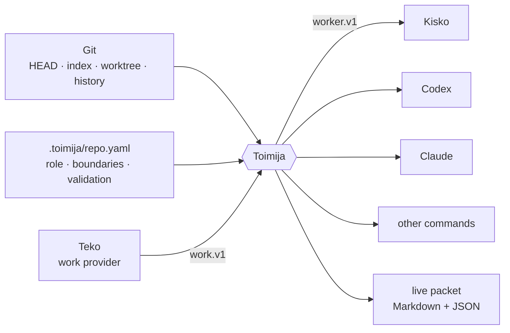
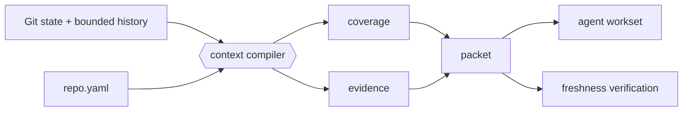

# Toimija

**Git-native context and runtime composition for coding agents.**


*Toimija* is Finnish for “the one who acts.”

> Git knows what repository state exists. Toimija turns that state into a
> bounded, verifiable contract for the agent that acts on it.

Toimija sits between a repository and a coding harness. It compiles local Git
state into a live context packet, optionally obtains bounded work from Teko,
launches Codex, Claude, Kisko, or another command, keeps the packet fresh while
the harness runs, and verifies the repository again at exit.

It is deliberately local and compositional. Teko, Toimija, and Kisko are
independent products that build and release separately. They meet only at
runtime through the public
[`false-agent-protocol`](https://github.com/false-systems/false-agent-protocol).

## Architecture



The ownership lines are strict:

| Product | Owns | Does not own |
| --- | --- | --- |
| **Teko** | Active work, objectives, obligations, required Gate IDs, completion policy | Gate commands, Git truth, harness execution |
| **Toimija** | Repository points, trusted gate catalog, gate execution and receipts, context packets, session lifecycle | Task assignment, model execution, work closure |
| **Kisko** | Model execution, actions, transcripts, structured worker results | Gate certification, repository truth, work closure |
| **Codex / Claude** | The work they perform inside the launched session | Teko or Toimija policy |

Toimija is the composition point, not a product monolith. It imports no Teko or
Kisko implementation crate. An absent provider simply leaves the corresponding
capability unbound unless the repository or command explicitly requires it.

## Why

Coding agents often enter a repository by globbing, grepping, reading, and
guessing. That cold crawl is expensive, repeats across agents, and can reason
from stale state.

> We do not ask the model to understand the repo first. We ask Git what state the repo is in.

Every Git repository already contains a content-addressed database describing
the current branch, HEAD, index, worktree, history, and merge relationships.
Toimija reads that evidence once and produces a bounded packet that answers:

- What repository and branch am I in?
- What changed in commits, the index, and the worktree?
- What should I read first?
- Which files tend to change together?
- Which areas are risky or high-churn?
- What validation commands does this repository expect?
- What work did Teko bind to this run?
- Does this packet still describe the live repository?

Git is not a save button here. Git is the substrate.

> Git gives us the graph of what happened. Toimija turns that graph into operational context for agents.

## Quick start

Build and install Toimija from a checkout:

```bash
git clone https://github.com/false-systems/toimija.git
cd toimija
cargo install --path .
```

Adopt it in a repository:

```bash
cd /path/to/repository
toimija init
toimija adopt --hooks
toimija run \
  --intent "fix authentication regression" \
  --scope src/auth/ \
  --task "repair the expired-session redirect" \
  -- codex
```

`init` creates `.toimija/repo.yaml` without overwriting an existing file.
`adopt --hooks` installs the small “read the live packet first” preamble in
recognized agent instruction files and adds best-effort Git refresh hooks.

`run` then:

1. Discovers the repository and compiles its current Git state.
2. Materializes an authoritative repository point.
3. Optionally asks a `work.v1` provider for active work.
4. Creates one canonical execution context.
5. Opens a per-session live packet under `.toimija/sessions/<id>/`.
6. Selects a built-in or external worker adapter.
7. Validates the launch plan and starts the harness directly.
8. Refreshes the packet on relevant repository changes.
9. Recomputes repository truth after the harness exits.
10. Normalizes the result and, for bound work, reports it to the work provider.

Known agents such as `codex`, `claude`, and `gemini` receive the packet in their
launch prompt. Other commands receive the session paths through environment
variables and are reported honestly as environment-only delivery.

Use `--` before harness arguments:

```bash
toimija run --intent unknown -- codex --help
```

## Runtime composition

### Work providers

A work provider implements `work.v1`. Teko exposes the capability with:

```bash
teko plugin serve --stdio
```

During a bound run, Toimija asks the provider for current work at an
authoritative repository point. The returned work packet may include:

- objective and scope;
- obligations and required gates;
- required completion level;
- current blockers and reachable completion.

At exit, Toimija refreshes the repository point and sends the normalized worker
result through `work.observe`. Evidence may support Teko's obligations, but only
Teko decides whether the work is closable. A worker claim cannot close work.

### Gate authority

Repository gates are separate from the advisory validation plan. Teko names
only stable Gate IDs. Toimija resolves those IDs from trusted configuration,
materializes the exact verified Git tree into a standalone disposable
repository, launches the configured executable directly with separate arguments
and a bounded environment, captures bounded output, and checks the materialized
source tree again before minting a receipt.

```bash
toimija gates list
toimija gates inspect rust-test
toimija gates run rust-full
toimija gates status
toimija verify-work
```

Every passing receipt binds the repository ref, repository-point ref, tree OID,
consistency token, Gate ID, gate-spec digest, output digests, environment
fingerprint, and duration. A repository or gate-definition change preserves
the receipt as history but makes it inapplicable to current closure. Toimija
does not claim hermetic execution or enforced network denial:
`unenforced_deny_requested` says exactly what the local runner proves.

`verify-work` asks active Teko work for required Gate IDs, executes each trusted
gate, imports only exact-current receipts, refreshes Teko status, and reports
what remains. It never closes the work.

Bounded work can be required for one invocation:

```bash
toimija run --require-work -- codex
```

Without `--require-work`, a missing or unavailable optional work provider
degrades to an unbound run.

After opening a pull request from the exact clean destination tree, bind it to
the completed bounded run:

```bash
toimija correlate-pr https://github.com/false-systems/kisko/pull/171
```

The command validates the local `origin`, session, worker result, repository
point, and commit without contacting GitHub. It writes a Sauma-attested
`.toimija/runs/<run>.correlation.json` connecting the Teko spec/work, Toimija
session and repository points, worker run, commit, evidence, and declared PR
reference. The producing session is derived from Toimija's finalized run
record; `--run` selects a specific run and `--session` asserts its producer.
`toimija explain-work` displays the link; `sauma why
github:false-systems/kisko#171` walks it.

### Worker providers

Built-in adapters launch Codex, Claude, Gemini, and generic commands through the
same execution-context path.

An external worker implements `worker.v1`. Kisko exposes it with:

```bash
kisko plugin serve --stdio
```

The worker lifecycle is:

| Method | Purpose |
| --- | --- |
| `worker.describe` | Report supported execution and context modes |
| `worker.prepare` | Return a structured, shell-free launch plan |
| `worker.finalize` | Normalize the exit outcome and structured result |

Toimija validates an external launch plan before executing it. The executable
must match the trusted user configuration, the working directory must be the
verified repository root, environment keys are allow-listed, protocol limits
are enforced, and runtime artifacts must stay inside the session directory.

### Provider configuration

Trusted executable paths belong to user configuration, not repository
configuration:

```toml
# $XDG_CONFIG_HOME/toimija/plugins.toml
# or ~/.config/toimija/plugins.toml

automatic_path_discovery = true

[plugins.teko]
kind = "work"
command = "teko"
args = ["plugin", "serve", "--stdio"]
required = false
timeout_ms = 5000

[plugins.kisko]
kind = "worker"
command = "kisko"
args = ["plugin", "serve", "--stdio"]
required = false
timeout_ms = 5000
```

When automatic discovery is enabled, the exact executable names `teko` and
`kisko` may be discovered on `PATH`. There is no arbitrary plugin scan.
Repository configuration may select a provider ID, but cannot introduce an
executable path.

Inspect the effective providers before running:

```bash
toimija plugins list
toimija plugins doctor
toimija plugins inspect teko
```

## The neutral protocol

All runtime messages use
[`false-agent-protocol` v0.1.1](https://github.com/false-systems/false-agent-protocol/tree/v0.1.1).
It is a public, product-neutral Rust crate and wire contract.

The protocol defines:

- protocol negotiation and capability IDs;
- `work.v1` and `worker.v1`;
- typed repository, work, run, evidence, action, and digest references;
- JSON-RPC-style requests and responses;
- `Content-Length` framing over stdin/stdout;
- canonical SHA-256 digests;
- stable error codes and compatibility fixtures;
- frame, string, argument, environment, and collection limits.

It intentionally contains no Git operations, process execution, async runtime,
storage, workflow policy, or product behavior. The protocol describes messages;
each product decides what those messages mean and what authority it retains.

This keeps builds independent:

```text
teko checkout      ── cargo build ──▶ Teko
toimija checkout   ── cargo build ──▶ Toimija
kisko checkout     ── cargo build ──▶ Kisko
                          │
                          └── public false-agent-protocol tag
```

No build requires a sibling checkout, local path dependency, private deploy key,
or another product binary.

## The live packet

Toimija writes human-readable Markdown and complete machine-readable JSON:

```text
.toimija/current.md
.toimija/current.json
.toimija/sessions/<id>/current.md
.toimija/sessions/<id>/current.json
```

The per-session packet is authoritative for a wrapped harness. The repo-level
pair is a last-writer-wins summary for sessionless readers.

A packet combines:

- branch, HEAD, upstream, merge-base, and recent commits;
- staged, unstaged, untracked, renamed, and conflicted paths;
- unsafe Git operation state;
- the committed branch surface;
- a Git-derived workset and ordered reading plan;
- coupling and risk hints with evidence and confidence;
- collection coverage: `available`, `degraded`, or `failed`;
- repository boundaries, exclusions, and validation plans;
- session identity, entry baseline, declared intent, and scope;
- optional active work and canonical execution context;
- a content-based consistency token;
- a Sauma provenance envelope.

Every packet carries a workset contract:

> Work from the compiled workset and read order. Treat configured exclusions as
> do-not-scan. If a concrete dependency requires reading outside the workset,
> declare that expansion first. Expansion is never forbidden; invisible
> expansion is.

Markdown is budgeted for agents; optional sections are omitted atomically and
reported by name. JSON remains complete. Safety state, warnings, exclusions,
and the workset contract are never silently clipped.

Before commit or handoff:

```bash
toimija verify
```

`verify` recomputes live Git state and checks the packet's content-based token.
Same-size edits, index changes, conflicts, and unsafe Git operations cannot hide
behind timestamps.

## Sessions and collaboration

Each `toimija run` creates a separate session directory, so concurrent agents do
not race on one shared packet.

```bash
toimija sessions
toimija sessions --json
```

The session listing reports live, stale, and closed sessions plus descriptive
overlap warnings for branch, worktree, intent, and scope. These are awareness
signals, not locks or assignments.

A wrapped agent can update its own declaration:

```bash
toimija intent "repairing token refresh" --scope src/auth/
```

It can leave a durable continuation record:

```bash
toimija handoff "redirect fixed; rerun the integration gate"
toimija handoff --show <session-id>
```

Closed sessions are summarized in `.toimija/history.jsonl`. Stewardship remains
explicit and bounded:

```bash
toimija clean --dry-run
toimija clean
```

Toimija does not assign tasks, choose priorities, or decide which agent should
work. GitHub issues, pull requests, labels, and the human remain the coordination
layer.

## Trust and security

The runtime boundary is intentionally narrow:

- no Rust dynamic libraries or product implementation imports;
- no repository-controlled executable paths;
- no network access or plugin downloads;
- no hidden daemon or background service;
- no shell interpolation of plugin-returned launch plans;
- framed protocol output on stdout and provider logs on stderr;
- initialization and request timeouts;
- response and request-ID validation;
- bounded protocol values and collections;
- runtime artifact containment inside the session directory;
- graceful plugin shutdown followed by termination and reaping if necessary;
- authority checks that prevent providers from replacing repository truth;
- authority checks that prevent worker evidence from closing Teko work.

Toimija invokes plugins and harnesses only during an explicitly requested
foreground command. Optional provider failure is visible but non-fatal; required
bounded work fails closed.

## Git-native context

Runtime composition builds on Toimija's original job: turning Git plumbing into
agent-facing porcelain.



Toimija does not maintain a second repository index. Snapshots use Git tree
objects; relevance uses bounded Git history; freshness uses content-derived
tokens. When evidence is missing, the packet says so instead of converting
failure into an empty, reassuring list.

## Commands

| Command | Purpose |
| --- | --- |
| `run --intent "..." -- <harness>` | Compose context, launch a harness, refresh, finalize, and summarize |
| `plugins list|doctor|inspect` | Inspect configured and discoverable runtime providers |
| `repository-point` | Export authoritative versioned repository truth |
| `explain-work` | Explain active work, latest bound result, evidence, and blockers |
| `enter`, `context`, `refresh`, `watch` | Produce or maintain a live packet |
| `verify`, `snapshot` | Verify freshness or materialize an immutable Git tree |
| `gates`, `verify-work` | Execute trusted gates on exact snapshots and import current receipts |
| `sessions`, `intent`, `handoff`, `history` | Observe and record local session continuity |
| `clean` | Reclaim expired Toimija-owned artifacts |
| `audit-plan` | Partition a broad review into bounded deterministic worksets |
| `validate --plan` | Render validation commands without executing them |
| `landed` | Check whether branch content reached a base ref |
| `init`, `adopt`, `doctor` | Configure a repository and detect setup drift |

Use `toimija <command> --help` for flags and examples. The
[complete reference](docs/reference.md) documents packet fields, environment
variables, configuration, output guarantees, and every command.

## Repository configuration

`.toimija/repo.yaml` gives durable meaning to live Git state:

```yaml
repo:
  name: example
  role: service that processes customer events
  not:
    - deployment controller

composition:
  work: teko
  require_work: false

context:
  default_budget: 8000
  important_docs:
    - README.md
    - AGENTS.md
  read_first: []
  safe_to_ignore:
    - target/

validation:
  replace_inferred: false
  fast:
    - cargo test
  strict:
    - cargo fmt --check
    - cargo clippy --all-targets -- -D warnings
  full:
    - cargo test --workspace
  privileged: []

gates:
  rust-format:
    description: Rust formatting check
    program: cargo
    args: [fmt, --all, --check]
    timeout_seconds: 60
  rust-test:
    description: Full Rust test suite
    program: cargo
    args: [test]
    timeout_seconds: 900

gate_groups:
  rust-full:
    gates: [rust-format, rust-test]

boundaries:
  - Do not add network calls.
  - Keep runtime providers optional.
```

`toimija doctor --strict` checks that repository boundaries and major
documentation remain aligned.

## Language and validation support

Rust and Elixir have full adapters. Go, Python, and JavaScript/TypeScript receive
the minimum language pack: repository detection, evidence-backed validation
hints, and companion-test discovery. Other repositories work through explicit
`.toimija/repo.yaml` configuration.

Adapters contribute planning hints; they do not parse source code. `toimija
validate --plan` prints commands and provenance but never executes them.

## Boundaries

Toimija intentionally does not:

- make model-provider calls;
- assign or dispatch work;
- apply patches or commit changes;
- treat advisory validation-plan strings as executable gates;
- fetch repository or plugin data from the network;
- run a daemon after the invoked command exits;
- dynamically load product code;
- build an MCP, LSP, SCIP, Kythe, or Tree-sitter index;
- persist a semantic graph.

Relevance remains file-level, bounded, heuristic, and advisory. Coverage says
what Toimija successfully observed, not what it knows with certainty.

## Development

Toimija is one Rust crate. The development-only `xtask` installs the
pre-commit hook but is excluded from ordinary root builds.

```bash
git clone https://github.com/false-systems/toimija.git
cd toimija
cargo build
cargo run -- context
```

Before claiming completion:

```bash
cargo fmt --check
cargo clippy --all-targets -- -D warnings
cargo test
```

Install the pre-commit hook once per clone:

```bash
cargo xtask install-pre-commit-hook
```

Release artifacts are built by GitHub Actions for `v*` tags. The public protocol
dependency is fetched over HTTPS, so a fresh checkout requires no sibling
repository or private Git credentials.

## Documentation

- [Complete command and packet reference](docs/reference.md)
- [Cross-tool packet contract](docs/joskus-contract.md)
- [Design proposals](docs/proposals/)
- [Audit history](docs/audit/)
