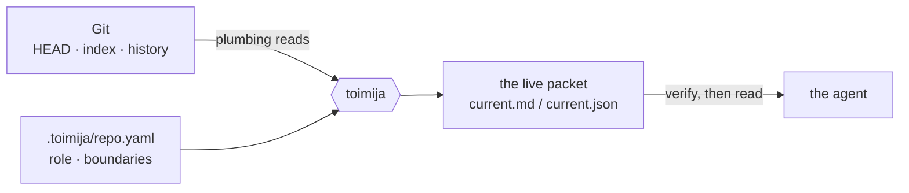
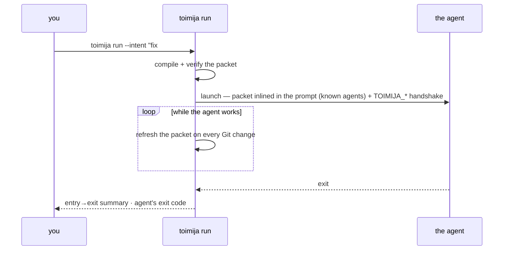
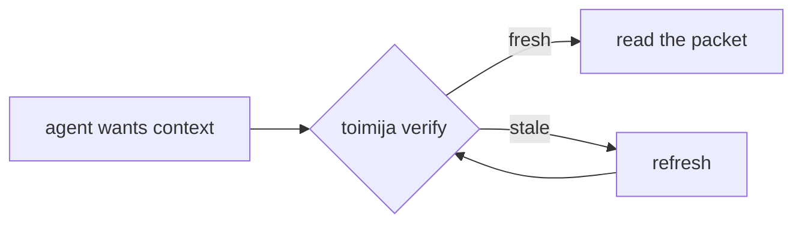
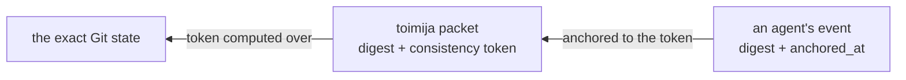

# Toimija reference

The complete manual: every command, the packet anatomy, the environment
handshake, configuration, language support, and output guarantees. For the
pitch and the 30-second start, read the [README](../README.md).

Instead of running `codex` directly, run `toimija run codex`.
Instead of running `claude` directly, run `toimija run claude`.

Toimija refreshes the repo context, writes `.toimija/current.md` and
`.toimija/current.json`, starts a watcher, launches the agent — for known
agents with the packet inlined in the launch prompt — keeps the packet fresh
while the agent works, and exits with the wrapped command's status.

> We do not ask the model to understand the repo first. We ask Git what state the repo is in.

## Toimija in 30 seconds

```bash
cargo install --path .          # or grab the release artifact
cd /path/to/repo
toimija init                    # once per repo: seed .toimija/repo.yaml and .gitignore
toimija run claude              # every time: start the agent as a session
```



## Porcelain for agents

Git's own manual splits its commands into **plumbing** (stable, machine-facing
primitives: `rev-parse`, `ls-tree`, `write-tree`) and **porcelain** (the human
interface built on top: `status`, `log`, `commit`). The porcelain is just one
client of the object database underneath — anyone can write another.

Toimija is another porcelain, purpose-built for a different client: **an agent,
not a human at a prompt.** Same pipes, different sink.

That is the whole design move, and it repeats at every layer:

- **Context** is compiled from plumbing reads — no index to keep fresh, Git's
  state machine *is* the state.
- **Snapshots** are `write-tree` plus a ref — immutable, content-addressed,
  garbage-collected by git itself.
- **Freshness** is a content-based token — the same content-addressing trick
  git's object model is built on, applied one layer up.
- **Provenance** (the packet's seal) is passive files plus a reader — the same
  shape as git itself: no service, no daemon.

Every repo already ships a battle-tested, content-addressed, distributed
database that every machine and every CI system knows how to replicate: `.git`.
Toimija refuses to build a second one. The design test for any new need is
*"does git already store this?"* — before writing a line of infrastructure.

## Why

Every coding agent enters a repo the same way: glob, grep, read, guess. That
cold crawl is slow, costs tokens, and is wrong the moment the repo moves. Yet
every repo already ships a database that knows exactly what is going on — Git.
Toimija reads it once, compiles it into a small packet, keeps that packet
verifiable against local Git state, and hands it to the agent as a bounded
starting point instead of a cold crawl.

What you get:

| | |
|---|---|
| **A live work packet** | Branch, HEAD, merge-base, changed surface, warnings — refreshed on every relevant change while the agent works. |
| **A workset contract** | Every packet opens with a normative contract: work from the Changed surface and Read first, exclusions are do-not-scan, and any expansion outside the workset is declared — *expansion is never forbidden; invisible expansion is.* |
| **Wrapped means used** | Under `run`, using toimija is not voluntary: an explicit intent is required to launch, known agents get the packet **in their launch prompt** (argv — they cannot not-see it), and the exit summary reports what the session actually consumed. |
| **What to read first** | The repository's configured and important docs, always and first, then the changed files and their companion tests by existence-checked path. Advisory; no history mining, no source parsing. |
| **Verifiable freshness** | Every packet carries a content-based consistency token; `toimija verify` proves it still matches the repo before anyone trusts it. |
| **Multi-agent awareness** | Per-session packets, `toimija sessions` presence + overlap warnings, and bounded stewardship. Visibility, never orchestration. |
| **Chain of custody** | Every packet carries a seal — a canonical digest plus provenance edges — so artifacts across tools verify against the exact repo state they were built from. |
| **Validation planning** | `validate --plan` prints inferred and configured commands with their provenance — full adapters for Rust/Elixir, a minimum language pack floor for Go/Python/JS-TS/Terraform. A repo with `sykli.json` gets its declared gate instead (`mkdir -p .sykli && sykli run sykli.json --json > .sykli/receipt.json && sykli verify .sykli/receipt.json --contract sykli.json`, `source: sykli.json`). It never runs commands. |
| **Squash-proof landing checks** | `toimija landed` answers "did this branch land?" by content, where ancestry lies. |

## What Toimija is

Toimija is a Git-aware local context compiler and live entrypoint for coding
agents.

It combines:

- durable repo meaning from `.toimija/repo.yaml`
- live Git state
- language adapter hints
- validation plans

into:

- `.toimija/current.md` — the readable live packet
- `.toimija/current.json` — the machine-readable live packet

Agents should work from those files instead of reading the repo cold.

Git is not a save button here. Git is the substrate.

> Git gives us the graph of what happened. Toimija turns that graph into operational context for agents.

## The normal workflow

```bash
cd /path/to/repo
toimija run --intent "fix #51" --task "fix the login redirect" -- codex
```

```bash
cd /path/to/repo
toimija run --intent "explore the failing CI" -- claude
```

`run` is the recommended agent entrypoint. It runs `enter`, starts `watch`,
launches the agent command, stops watching when the agent exits, and returns the
agent command's exit status (signal termination is preserved too, e.g. SIGTERM →
143).

For the built-in Codex adapter, omitting `--task` (or giving a blank task)
delivers the packet and optional `--briefing` as per-session
`developer_instructions`, without a positional message. The TUI waits for
the first user task without requesting a model acknowledgement. Codex adds
the setting to its own developer instructions (skills, permissions,
collaboration mode), so the slot carries only the packet and the briefing;
`codex debug prompt-input` with the same options shows the result offline. A
`developer_instructions` set in your own Codex config is replaced for that
session. One passed on the command line (`-c developer_instructions=…`) is
kept: the launch is then not idle, the packet goes in the first message, and
`run` says so on stderr.
Explicit tasks keep positional delivery, and an `agents.codex` configuration keeps its
declared prompt style. Subcommands such as `codex exec` and `codex resume`
retain prompt delivery rather than being inspected as interactive launches.

**Wrapped means used** (proposal 0006). `--intent` says why a session
exists; a launch without one is said once and shows as `unknown` to sibling
sessions until `toimija intent` declares it (proposal 0006 refused such a
launch; since 2026-11 it does not). For known agents (`claude`, `codex`, `gemini`, `pi`
and `opencode`, matched by basename: opencode takes the prompt after `--prompt`,
since its one positional argument is the folder to start in, except `opencode
run`, which takes it as its message; the others take it as a positional
argument) — and for any agent
configured under `agents:` in `.toimija/repo.yaml` (`prompt: positional`, or a
flag such as `prompt: --message`; configuration wins over the built-ins) —
the packet is delivered **in the launch prompt
itself**: `run` appends one argument (after `--prompt` for opencode, but not for
`opencode run`) carrying the contract framing,
the entry packet inlined at the session budget, the live packet path, and your
`--task`. The agent cannot not-see it. Pass the agent's task via `--task`, not
as the agent's own positional argument. Unknown agents keep the env-var
handshake behind an honest banner — `delivery: env-var only — not guaranteed` —
never a silent degradation. A warning names what the agent was not handed
(`not delivered: packet, task, briefing`), and the session marker records it
as `undelivered`, so `sessions --json` shows it after the fact.

`--briefing` carries background instructions apart from the task. A known or
configured agent gets them at the end of its launch prompt, after the packet
and the task (for `claude`, in the same positional prompt); an idle Codex launch
gets them after the packet in its session instructions. An agent toimija does
not recognise has no launch prompt, so it cannot receive them. A blank
`--briefing`, like a blank `--task`, is none, and both may start with `-`.
Written with a space, neither, nor an `--alert`, may be followed by one of
`run`'s own flags or the `--` before the command: there the value was left
out, so `--briefing --task "fix it"` is refused as a usage error (exit 2) before
a session opens, rather than taking `--task` as the briefing and launching a
program named `fix it` (issue #237). The `=` form says the value is intended:
`--task=--briefing` passes the text `--briefing`.

`--alert <TEXT>` (repeatable) is for the few lines the agent must read first,
such as a launcher's FLAGGED or WARNING lines. They open the launch prompt
(and an idle Codex launch's session instructions) under `## Before anything
else (from the launcher)`, above the contract and the packet, each with its own
text. They are capped at 1024 bytes in total: the rest is cut at a character
boundary, the block says so, and `run` warns on stderr. A blank alert is none.
An unrecognised agent gets the same `not delivered: alert, …` warning as for
the packet. Launchers can detect support with `toimija run --help`.

Launch prompts tell agents to use delivered facts instead of repeating
discovery. Missing, stale or contradictory facts justify a refresh; unresolved
task details justify reading the named files. Outside a repository, an unassigned
session waits for work before invoking discovery or bookkeeping tools. This
does not waive scope declarations or pre-commit/handoff verification.



What follows the agent's name is the agent's own, flags included: `toimija
run codex --help`. A `--` before the agent is accepted and not needed.

Each `run` opens a **session** with its own live packet under
`.toimija/sessions/<id>/`, so concurrent wrapped agents do not race on a single
shared file. While the agent works, that session packet stays fresh: every
relevant filesystem or Git-state change re-runs the refresh after a short
debounce. After laptop sleep, the resumed watch loop re-proves the session within
one tick through that same refresh and heartbeat path.

The watcher finds the repository's git dir and common dir once, and an idle
tick starts no git process. Work-tree edits arrive as filesystem events: the
platform-native watcher (FSEvents on macOS, inotify on Linux) is armed first
and reports `armed (native)` only after a readiness probe is observed.
Read-only access events (open, read, close without writing) are dropped, so
the refresh's own reads never re-trigger it. If native cannot arm — the inotify
watch limit, say — or its probe times out, macOS re-arms and re-proves notify's
polling backend (`armed (poll fallback)`), and Linux falls back to Git polling
(`armed (git polling)`): one `git status` per tick, never a recursive scan of
the tree. The fallback is logged once.

Every 500 ms the watcher also compares the metadata of the Git files a packet
depends on — HEAD, the index, the operation markers, the refs (files or
reftable, a linked worktree's own included), packed-refs, config, `shallow`,
`info/grafts`, `objects/info/alternates`, `info/exclude` and
`.toimija/repo.yaml` — read with `stat` alone, no git process. A moved ref,
config, graft or alternates file refreshes the packet; a moved HEAD or index is
checked first with one `git status`, because other tools rewrite the index
without changing anything the packet shows. This is how staging, commits,
branch switches, a fetch that moves the upstream, and a worktree or branch
added elsewhere reach the packet, also in a linked worktree whose git dir lies
outside the watched tree. A tracked path is never ignored: events under a
directory with a build name (`target/`, `_build/`, `deps/`, `node_modules/`),
at the repository root or deeper (a monorepo's `packages/a/node_modules/`),
prompt one `git status` instead of a refresh. That check shows a tracked file
there as modified, and an already-modified one by its content, and refreshes
for it; untracked build output shows as nothing and costs only the check. Only
a whole name counts: `src/targeted.rs` is source.

A refresh reads one `git status`. While that metadata says the refs have not
moved since the last packet's Git state was read, and `status` finds HEAD and
the upstream where that read did, the packet's ref-derived facts — the base,
the merge-base and the branch diff from it, the recent commits, ahead/behind
counted against the base, `shallow` — are carried from that read rather than
read again. A ref, HEAD or upstream that moved is read again. `run`'s entry
gate and its exit refresh read the same way, so `run` costs what `enter` costs
plus nine git processes however long the agent works: the repository point's
six, and one `git status` each for the gate, the catch-up and the exit
(`tests/cli_budgets.rs` pins every command's count).

Once a minute a safety net compares one `git status`, and the changed files'
contents, with the packet, so what no event and no metadata reported — a
dropped event — leaves the live packet stale for a minute at most while the
loop turns. Known slow cases, both rare: a change to a global excludes file
(`core.excludesFile`) waits for that minute or the next real change, and one
to global git config the packet shows (`core.abbrev`) for the next refresh
that reads the refs. And the debounce waits for a
300 ms gap in events, so steady churn — a long build writing `target/` —
delays refreshes until it pauses.

When a refresh itself fails — an unparseable `.toimija/repo.yaml`, say — the
packet cannot be rebuilt, so it says so instead:
a notice at the top of the Markdown packet names the failure and since when,
above the last good content, and the next successful refresh replaces it. The
failure is written, and logged, once per distinct error rather than on every
retry. A failed refresh is retried at once on the next change, and otherwise
after half a second, then after a delay that doubles up to the safety net's
minute. It is
foreground-only and stops the moment the agent exits — no daemon survives the
command. The repo-level `.toimija/current.*` is kept too, demoted to a
last-writer-wins "latest" summary for sessionless readers. It mirrors the
session block only while the session runs; the exit refresh, which runs after
the marker closes, writes the repo-level pair without it.
While a wrapped command runs, `run` re-points its own stdout and stderr at
`.toimija/sessions/<id>/diagnostics.log` (descriptor-level `dup2`) and hands
the saved terminal to the child, so nothing this process prints — watcher
output, refresh warnings, panic messages included — can interleave with the
harness; `run` reports the captured line count and path after the command
exits. Standalone `watch`, which owns its terminal, prints those diagnostics
directly as before.

So the wrapped agent can *find* its live packet, `run` hands it an environment
handshake. For known agents this is the backup channel (the packet already
travels in the launch prompt); for everything else it is the only signal `run`
injects into the child:

| Variable | Meaning |
| --- | --- |
| `TOIMIJA_RUN=1` | The agent is under `run`; a watcher is keeping the packet fresh. |
| `TOIMIJA_SESSION` | This session's id (`<unix-secs>-<pid>`). `toimija intent`, `enter`, and `refresh` use it to find the session. |
| `TOIMIJA_LIVE` | Absolute path to this session's live `current.md` (authoritative). |
| `TOIMIJA_LIVE_JSON` | Absolute path to this session's live `current.json`. |
| `TOIMIJA_CURRENT_MD` | Alias of `TOIMIJA_LIVE`, for harnesses that key on the file name. |
| `TOIMIJA_CURRENT_JSON` | Alias of `TOIMIJA_LIVE_JSON`. |
| `TOIMIJA_REPO_ROOT` | Absolute path of the repo root the session runs in. |
| `TOIMIJA_RUN_ID` | Alias of `TOIMIJA_SESSION`. |
| `TOIMIJA_REPO_LIVE` | Absolute path to the repo-level `current.md` summary. |
| `FALSE_SYSTEMS_REPOSITORY_POINT_PATH` | Absolute path to this session's current repository point, a false-agent-protocol `RepositoryPointEnvelope` (`.toimija/sessions/<id>/semantic-point.json`), rewritten on every refresh. Its tree is tree-identity.v1, named in `extensions.tree_algorithm`, and its token's version is in `extensions.consistency_algorithm`. |

An agent that honors the handshake re-reads `$TOIMIJA_LIVE` after HEAD, branch,
index, or unfamiliar worktree changes instead of re-running `enter`; its own
expected source edits do not require a full re-read. Before commit or handoff,
`toimija verify` is the freshness boundary.

Codex receives the same generated values as individual
`-c shell_environment_policy.set.<name>=<value>` arguments, so tool commands
in its persistent daemon receive this run's identity rather than depending on
the daemon's startup environment. Values are quoted as TOML-compatible strings;
unrepresentable non-UTF-8 values fail before launching. No global Codex config,
inheritance policy or sandbox setting is changed. Other agents retain the
ordinary environment handshake. Outside repositories, `TOIMIJA_STATE_DIR` is
also set to the resolved session-state location, so `intent` finds the marker
even when the daemon started with a different state directory. Each variable
`run` removes from the agent's environment (`FALSE_SYSTEMS_RESULT_PATH`,
`FALSE_SYSTEMS_CONTEXT_PATH`, and outside repositories `TOIMIJA_LIVE_JSON`,
`TOIMIJA_CURRENT_JSON`, `TOIMIJA_REPO_ROOT`, `TOIMIJA_REPO_LIVE`,
`FALSE_SYSTEMS_REPOSITORY_POINT_PATH`) is set to `""` for Codex tools, because
`set` can only add variables and a daemon started by an earlier session may
still hold its values. Toimija reads an empty handshake value as unset; other
readers should too.

Each session also writes a `.toimija/sessions/<id>/session.json` marker (id, pid,
when that process started (`pid_start`: Linux and macOS, an opaque token
compared only for equality, so a reused pid is not taken for the session),
agent argv, worktree, branch, HEAD, intent, scope, timestamps, status) that
`run` auto-closes on exit. The marker is what `toimija sessions` reads (below).
The entry branch and HEAD remain fixed in later packets; if current Git state
moves, mandatory Markdown renders a `Session drift` block and JSON retains both
the entry baseline and current `git` state.

### Outside a repository

In a folder that is not inside a Git repository, `run` opens a session with no
packet instead of refusing (issue #225). There is no Git context to compile, so
there is no entry packet, watcher, repository point, or exit summary;
`--for-diff` and `--budget` are refused. What
remains is what makes the session visible:

- the marker, under the machine-local state directory — `$TOIMIJA_STATE_DIR`,
  else `$XDG_STATE_HOME/toimija`, else `~/.local/state/toimija` — at
  `<state>/.toimija/sessions/<id>/session.json`, with `worktree` set to the
  folder. Nothing is written in the folder itself;
- a heartbeat every minute, since no watcher stamps `last_seen_at`;
- `TOIMIJA_RUN=1`, `TOIMIJA_SESSION`, `TOIMIJA_RUN_ID`, and `TOIMIJA_LIVE` /
  `TOIMIJA_CURRENT_MD` naming a short note that says why there is no packet.
  The repository-only variables (`TOIMIJA_LIVE_JSON`, `TOIMIJA_CURRENT_JSON`,
  `TOIMIJA_REPO_ROOT`, `TOIMIJA_REPO_LIVE`,
  `FALSE_SYSTEMS_REPOSITORY_POINT_PATH`) are cleared, so values inherited from
  an outer session cannot leak in;
- for known agents, a launch prompt that says there is no packet, then the task.

`toimija sessions --outside-repos` (the default when not inside a repository)
lists these sessions, and `toimija intent` finds its session there even after
the agent changes into a repository. Sessions inside the repositories the agent
touches do not count it as a sibling: its declared scope is how they can know.

## Multi-agent sessions

Several agents can work one repo at once without trampling each other's context.
Each wrapped agent gets its **own** session packet, and `toimija sessions` makes
the others visible.

Declare why you're here (and optionally what you'll touch) when you launch — it's
advisory, never an assignment or a lock:

```bash
toimija run --intent "add sessions command" --scope src/sessions.rs -- codex
```

The wrapped agent can also speak for itself, mid-session — it finds its own
marker through the `TOIMIJA_SESSION` handshake:

```bash
toimija intent "migrating the auth module" --scope src/auth/
```

Launch-time `--intent` belongs to the human; `toimija intent` lets the agent
declare (or sharpen) it once it actually knows what it is doing. Same rules:
advisory text on the session marker, never an assignment, never a lock.

Then, from anywhere in the repo, see who else is live:

```bash
toimija sessions          # human listing: LIVE / STALE / CLOSED + warnings
toimija sessions --json   # same, machine-readable (carries marker-scan coverage)
toimija sessions --prune  # run the configured stewardship pass
toimija clean --dry-run   # preview all expired Toimija-owned artifacts
```

Concluded sessions stay visible after their directories are reclaimed:

```bash
toimija history
```

Concluded sessions are distilled into the append-only
`.toimija/history.jsonl`. `run` records clean teardown immediately; pruning
journals an unrecorded closed or stale session before removing its directory.
Append failure keeps the directory. `toimija history` renders newest first;
`--json` emits every valid record as an array. Malformed lines are counted and
skipped. The v1 shape is documented by
`docs/schemas/history-record.v1.schema.json`. History records no handoffs, so
it writes `handoffs` and `handoffs_total`, which v1 requires, empty. The one
handover concept is now Toimija's own `toimija handover` (issue #251), which
replaced ohjaa's (decision D8.4 made ohjaa's the one concept; ohjaa no longer
runs sessions): a note per working copy, shown in the packet, not a history
record.

```
LIVE
  claude  1782675584-99172
    branch: feat/sessions-awareness
    worktree: /Users/yair/projects/toimija
    intent: add sessions command
    scope: src/sessions.rs
    started: 12m ago
    seen: 8s ago
    packet: .toimija/sessions/1782675584-99172/current.md

WARNINGS
  - 2 live sessions on branch feat/sessions-awareness: claude (…), codex (…)
```

`sessions` is read-only and local: it reports presence, resolves best-effort
liveness (`active` / `stale` / `closed`), exposes the separate `pid_check`
(`alive` / `dead` / `unknown`) in JSON, and warns when sessions overlap (same
branch, same worktree, intersecting declared scope, unknown intent, …).
Staleness measures **inactivity, not lifetime**: `run`'s watcher stamps a
`last_seen_at` heartbeat on the marker at every packet refresh, and a session
is stale when its process is gone or it has shown no activity for 90 minutes —
so a day-long working session stays `LIVE`, while a frozen one decays honestly
(see `docs/proposals/0002-heartbeat-staleness.md`). The
warnings are **descriptive, never prescriptive** — Toimija coordinates
visibility, not decisions. It never assigns work, signals or kills an agent, or
touches the network. The human remains the orchestrator. Prefer separate
worktrees for true isolation: same codebase, separate sessions.

Toimija-owned working artifacts do not accumulate forever. `toimija clean`
runs one stewardship pass over closed or stale sessions past retention (live
and unreadable sessions are never touched), old `.toimija/runs/*` transcripts,
and exact `*.tmp-{pid}-{sequence}` atomic-write leftovers older than one hour.
Sessions are journaled before deletion; append failure keeps the directory.
`--dry-run` lists the same candidates without deleting or compacting anything.
`enter` and `run` invoke that pass at the end of setup when `auto_sweep` is
enabled; those automatic sweeps log one warning and never fail the command.
`sessions --prune` remains available and uses the same implementation.
The pass never enters a symlink: when `.toimija`, `.toimija/sessions`, or
`.toimija/runs` is anything but a real directory it refuses outright (an
explicit `clean` fails and says why), and nothing is deleted unless its parent
resolves inside the repository's own `.toimija/`.

The same holds for everything Toimija writes. Every directory it writes into
under `.toimija/` must be a real directory, checked from the repository root
down; files are opened with `O_NOFOLLOW` and replaced by rename, so a symlink
is refused or replaced, never written through. A committed `.toimija ->
../elsewhere` makes `enter`, `refresh`, `run`, `init`, `snapshot --lease`, and
`clean` fail loudly and write nothing. Outside `.toimija/` Toimija writes no
files at all: AGENTS.md, CLAUDE.md, Git hooks and harness settings stay yours.

When the agent exits, `run` prints a one-glance session summary to stderr —
diffing the Git state from entry to exit so you see what the session actually
did (a switched branch, a moved HEAD, the working tree it leaves behind,
branch scope since the merge-base, refresh count), plus a consumption report
built purely from toimija-owned state — the session marker, never anything
observed about the agent — so non-use is visible
instead of silent:

```
toimija run: session summary
  branch:    main → feature/login
  HEAD:      a1b2c3d → e4f5a6b (moved)
  worktree:  2 staged, 1 unstaged, 0 untracked
  scope:     4 file(s) changed on this branch since merge-base
  refreshed: 12 time(s) while you worked
  intent:    "add login flow" (declared at launch)
  expansions: 2 scope path(s) declared while working
```

The worktree line counts the repository's work. Toimija's own files are never
counted, even where Git lists them (a repository without `toimija init` has no
`.toimija/.gitignore`), and neither are `.teko/` and `.sykli/`: the paths
`dirty` and the token leave out. The packet treats them the same way: the JSON
keeps them in its file lists, as Git reported them, and the Markdown counts
them apart (`- untracked: 0 (+9 generated, not counted)`) and names them in one
line under each list. They raise no warning and are in neither the changed
surface nor Read first.

## Verify before read — the packet is a claim, not a hope

A context packet is only useful while it still matches the repo. A map an agent
trusts *after* the territory moved is worse than no map. So Toimija makes
freshness checkable instead of assumed, in three escalating moves:



1. **Fingerprint.** Every packet embeds a `toimija-consistency-v3` token — a
   deterministic, content-based fingerprint of what `git status` lists (HEAD,
   index, unstaged tracked content, untracked content, conflicts, in-flight Git
   operations). No clocks, no mtimes, no file sizes: same content, same token.
   It leaves out exactly what faija's tree-identity.v1 leaves out — generated
   state under `.toimija/`, `.teko/` and `.sykli/`, but not
   `.toimija/repo.yaml`, which always counts — so refreshes, sessions,
   snapshots, harness runs and a gate's receipts never invalidate the packet.
   The token is a freshness check, not an identity: what `git status` does not
   list, it does not see (README, "Repository points", "Known gaps"). (v2,
   before KATANA D9, also watched `.sykli/`.)
2. **Gate.** `toimija verify` (`--json` for machines) verifies the ambient session packet when wrapped by `run`, and the
   repo-level packet otherwise. `--packet <path>` selects one explicitly. It
   recomputes the fingerprint against the live repo and exits
   non-zero, with reasons, when the packet is stale, missing, unsupported,
   unsafe, or unverifiable. A packet whose token is of an earlier version
   (`toimija-consistency-v2` or `-v1`) is `not_comparable`: its token keeps the
   meaning it was written with, so it is neither fresh nor stale, and a refresh
   replaces it. A harness calls this before *every* packet read:
   pass → trust the packet; fail → refresh first. `run` performs the same check
   on its own entry packet before launching the agent. It retries one startup
   race, then refuses to launch if the packet is still stale, unverifiable, or
   Git is in an in-progress operation or conflict state.
3. **Freeze.** When "fresh right now" is not enough — a reader that must see
   one coherent version while the worktree keeps moving — `toimija snapshot`
   materializes the working tree (untracked included) as an immutable,
   content-addressed git tree object. Files are then readable *at that version*
   via `git cat-file`, and `--lease` pins the snapshot against `git gc` until
   released. The tree is faija's tree-identity.v1 (`.toimija/`, `.teko/` and
   `.sykli/` left out, `.toimija/repo.yaml` forced in), computed by the
   canonical procedure in the vendored `faija-terms`; snapshots, leases,
   repository points and session packets all carry that one tree and name it
   (`tree_algorithm`), with the token's version beside the token. The token is
   read again once the tree is written, so a move the token observes is never
   paired with the earlier token.

   A tree is identified by its oid, and a repository point by its id, which is
   derived from the tree: equal point ids mean equal trees, by construction.
   Equal tokens do not. A token can stay put while the tree changes: an
   ignored, untracked `.toimija/repo.yaml`; commits inside a submodule or a
   nested repository; `assume-unchanged` and `skip-worktree` files; edits the
   stat cache misses (`core.checkStat=minimal`, `core.trustctime=false`);
   namespace content a sparse checkout keeps out of the cone; and a change
   undone before the re-read (A → B → A). Each of those gives two point ids,
   and each stays a blind spot for freshness. A reader that needs one exact
   State compares tree oids or point ids, never tokens.

   A clean token (`dirty: false`) does not mean `tree == HEAD^{tree}`. A lease
   marker written before Toimija named its tree algorithm lists as
   `toimija-legacy`, and one written before it named its token's version lists
   as `token version unrecorded`: each keeps the meaning it was written with.

The token is a freshness check, not a timestamp and not an identity: verify
tells you whether what `git status` lists has changed; a snapshot gives you a
tree that cannot change, and a point gives that tree an id. Either way,
nothing reads repo state on faith.

## Chain of custody — the seal

Work done by agents should be auditable the way commits are: *what produced
this, from what state, and does it still verify?* Toimija's packets carry a
**seal** for exactly this — a small, versioned attestation block under the
packet's `seal` key. Its envelope format is `sauma-envelope.v2`, a name it keeps
from sauma, the tool that wrote the sealing code; sauma is archived, and Toimija
carries that code as its own (`src/seal.rs`, over the vendored canonical crate;
the design's history is proposal 0003). The digest covers the whole packet, the
seal included, without the seal's own `digest`:

- **`digest`** — sha256 over the artifact's canonical form: compact JSON with
  object keys sorted at every level. Canonical means *portable*: any tool, in
  any language, recomputes the same digest from the same content — a foreign
  walker can verify an artifact it did not produce.
- **`provenance`** — typed edges to what the artifact was built from (a git
  state, a consistency token, another artifact). The edge vocabulary is an
  **open enumeration**: readers must tolerate kinds they do not know.
- **`producer` + `anchored_at`** — who wrote it, pinned to which consistency
  token.

Because every envelope anchors to a consistency token, artifacts from
*different tools* link into one verifiable chain:



That chain reads: *this review was produced against this exact packet, which
was compiled from this exact repo state* — git-blame for agent decisions.
Convention first, deliberately: joining the chain means writing one JSON block
correctly, not importing a library or calling a service. There is no provenance
daemon, no graph database, no index — passive files plus a reader, the same
shape as git itself.

`cargo xtask why <digest|token|session-id>` is the in-repo dev walker: it
verifies the local sealed artifacts (Toimija's packets under `seal`, and other
tools' artifacts in `.toimija/runs/`, which carry the same envelope under the
key `sauma`), renders verified token/digest links as an indented chain,
tolerates unknown provenance edge kinds, and reports digest mismatches without
walking through them.

## One-time repo setup

```bash
toimija init            # seed .toimija/repo.yaml (never overwrites)
```

`init` creates the durable repo manifest, `.toimija/repo.yaml` — fill in
`role`, `not`, and `boundaries`; only a human can supply the repo's purpose
and limits. The generated packets (`.toimija/current.*`) belong in
`.gitignore`; they are not committed.

Agent docs stay yours. Tell agents there to run `toimija enter` first (or
launch them with `toimija run`, which puts the packet in the launch prompt);
Toimija installs no preamble, hook or harness setting on the repository.

> repo.yaml gives durable meaning. Git gives live work state. Toimija compiles both into current context.

## Current context

`.toimija/current.md` is the readable live packet. `.toimija/current.json` is the
machine-readable live packet. Both are regenerated by `refresh`, `enter`, `watch`,
and `run`, and are git-ignored.

The packet includes:

- an **artifact ID** shared by the Markdown/JSON pair; each file is atomically
  replaced, and JSON is authoritative if an interrupted refresh leaves IDs that
  do not match. The bytes are staged in `.toimija/tmp/`, whose own
  `.gitignore` (`*`) hides it from Git, so a reader that lists untracked files
  and then stats them (`git add --all`, as `sykli run` does) never meets a temp
  file the rename is about to take away
- branch / HEAD / dirty state: `dirty` reads the lists the consistency token
  reads, filtered as it filters them, so a path under `.toimija/`, `.teko/` or
  `.sykli/` (other than `.toimija/repo.yaml`) never makes a state dirty while
  the token and the point id say it is unchanged; the file lists themselves
  are what `git status` reported
- ahead / behind: commits HEAD has that its upstream lacks and the reverse, counted
  from local refs (no fetch); without an upstream, against `origin/<default>`,
  or, with no `origin` and exactly one other remote, that remote's default
  branch, which is then the base too; `git.ahead_behind_ref` names which. In a
  shallow repository Git counts only the history it has, and a cut can hide the
  commits both sides share, so the counts are left null there and the line
  says `unknown — the repository is shallow` while `ahead_behind_ref` still
  names the ref
- staged / unstaged / untracked files
- rename/copy origin paths and similarity when Git reports them, plus conflict
  index stages (mode and object ID)
- collection **coverage** on the branch diff
  (`available` / `degraded` / `failed` with a reason and source), so an empty
  list from a failed collection is never presented as a real observation
- changed surface
- read first: configured and important docs (always, first), then changed
  files and their companion tests
- validation plan
- warnings
- on per-session packets, a **session** block — the session's id, declared
  intent and scope, freshly read at each refresh (so `run --intent` and
  `toimija intent` reach wrapped harnesses), the entry branch and HEAD, and,
  while the session runs, an `execution` context carrying the session's
  repository point and changed surface (Kelpo reads
  `session.execution.repository` to bind evidence to a session). An ended
  session stands at no point: the last packet `run` writes for it, as it exits,
  has a session block and no `execution`. The point's tree is tree-identity.v1,
  named in `session.execution.extensions.tree_algorithm`, and its token's
  version in `session.execution.extensions.consistency_algorithm`; a packet
  without those names predates them
- a **consistency** block — a versioned `toimija-consistency-v3` freshness token
  over HEAD, staged/index state, unstaged tracked state, untracked state,
  conflict state, and unsafe Git operation state, leaving out what
  tree-identity.v1 leaves out
- a **refresh token** over the collected Git state — repository state only,
  never anything read from the observer's environment, so the same repo yields
  the same token from any process — used by `verify`, and by `watch` over the
  part one `git status` reads
- a **seal** — a local attestation digest and provenance edge set for the
  packet artifact, under the key `seal`

See **Verify before read** for what the token buys you, **Chain of custody**
for what the seal buys you, and **Example context output** below for a full
rendering.

### Packet compatibility

The JSON packet is the machine contract; Markdown is a bounded presentation of
the same artifact and may omit optional sections to meet its budget. The packet
names its schema in `schema` (and again in `seal.schema`):

- New optional fields may be added without a schema-version bump.
- Removing, renaming or changing a field bumps the schema version. The current
  schema is `toimija-context.v3`.
- `toimija-context.v3` is v2 with its envelope under the key `seal` instead of
  `sauma`, and nothing else changed: the envelope inside is the same
  `sauma-envelope.v2`, with the same fields, and its digest is the same rule
  over the packet as it now reads. A reader of v2 that reads `sauma.digest`,
  `sauma.provenance`, `sauma.anchored_at` or `sauma.schema` reads `seal.digest`
  and so on instead, and checks `schema` for `toimija-context.v3`. A digest
  recomputed by hand drops `seal.digest`, not `sauma.digest`, before
  canonicalizing. `toimija verify --json` reports a tampered seal as
  `seal_digest_mismatch` (was `sauma_digest_mismatch`).
- `toimija-context.v2` was v1 without its `relevance` block (scope, read order,
  coupling, risk and their history coverage).
- `verify` reads a packet under its own schema's rules only: one an earlier
  toimija wrote (`toimija-context.v2` or `.v1`) is `invalid_packet`, with a
  message naming its schema and `toimija refresh`, which replaces it. A
  `toimija run` started before the install keeps its own code, and its watcher
  rewrites its session's packets in the old schema a moment after each change,
  so for a packet that briefs a live session the message says so: a refresh
  holds only until that next change, and the way out is to restart the session
  under the installed toimija. Restart live sessions after installing.
- Consumers must ignore unknown fields and tolerate unknown provenance edge
  kinds.
- Unix paths are JSON strings when valid UTF-8 and `{ "bytes_hex": "..." }`
  otherwise. Consumers must accept both forms.
- Do not materialize additive defaults before verifying the seal's digest;
  verify the raw JSON value first.

`toimija verify --json` is the verify-before-read gate for machines. Exit 0
and `"status": "verified"` carry the selected `packet_path`, the consistency
`algorithm` and `token`, and the `artifact_digest`; any non-zero exit is a
refusal to trust the packet, with one of these statuses: `missing_packet`,
`invalid_packet`, `missing_consistency`, `not_comparable`,
`unsupported_consistency_algorithm`, `stale_packet`, `session_not_live`,
`seal_digest_mismatch`, `unsafe_git_operation`, `unverifiable_repository`,
`io_error`. A `stale_packet` whose consistency token still matches says so in
its message: only the ref facts changed (upstream, base, ahead/behind, after a
fetch or a push), and HEAD, the index and the working tree did not.

## Commands

Ordered by workflow:

```bash
toimija run codex                    # agent entrypoint
toimija run --intent "..." --task "..." -- claude  # task travels in the launch prompt
toimija run --intent "..." --scope src/x.rs -- codex  # declare what you'll touch (advisory)
toimija sessions           # who else is live in this repo (read-only awareness)
toimija intent "..."       # wrapped agent declares why it is here (via TOIMIJA_SESSION)
toimija handover --next "..."  # leave a note for the next agent in this working copy
toimija history            # durable records of concluded sessions
toimija clean --dry-run    # preview the unified stewardship sweep
toimija clean              # reclaim expired owned artifacts
toimija enter              # refresh + print the packet as agent preflight
toimija refresh            # recompute current.md/current.json
toimija watch              # keep current.* fresh on Git/filesystem changes
toimija context            # print the packet without wrapping an agent
toimija context --json
toimija context --identity --json  # only what repo.yaml says the repo is; one git process
toimija verify             # does the selected session/repo packet still match?
toimija verify --json      # machine-readable verify-before-read gate
toimija snapshot           # freeze the worktree as an immutable git tree (content @ version)
toimija validate --plan    # print the validation plan; never runs it
toimija repository-point --json  # the exact current repository point
toimija doctor             # check Toimija setup
toimija init               # create .toimija/repo.yaml if missing
```

| Command | What it does |
|---|---|
| `run <cmd>` | Agent entrypoint: enter, watch, launch command, return command status. `--intent` says why (optional); `--task` travels in the composed launch prompt of known agents; `--scope` declares what you'll touch (advisory). Use `--` before child flags. Exit summary includes the consumption report. Outside a repository: a session with no packet (see "Outside a repository"). |
| `sessions` | List sibling sessions live in this repo (read-only awareness); `--json` for machine output; `--prune` runs the same configured stewardship pass as `clean`; `--outside-repos` (the default outside a repository) lists sessions opened outside any repository. |
| `intent "<text>"` | Wrapped agent declares/updates its own session's intent (and `--scope` paths) via the `TOIMIJA_SESSION` handshake. Advisory, never a lock. |
| `handover` | Leave a note for the next agent in this working copy: `--unfinished`, `--next`, `--surprised` (at least one). Writes `.toimija/handover.json`, replacing the one before it, and refreshes the live packet; every packet built here shows it under "Last handover" with when it was written and the branch and HEAD at the time. No session needed. |
| `history` | List durable concluded-session records newest first; `--json` emits every valid record. Malformed lines are counted and skipped. |
| `clean` | Reclaim expired sessions, run transcripts, and exact orphan temp files; `--dry-run` lists candidates without mutation. Explicit cleanup propagates errors. |
| `enter` | Refresh and print the current packet as agent preflight. |
| `refresh` | Recompute `current.md`/`current.json`. |
| `watch` | Keep `current.md`/`current.json` fresh on Git/filesystem changes. |
| `context` | Print the context packet without wrapping an agent. `--identity --json` prints only what the repository says it is — the packet's `repo` object, from `.toimija/repo.yaml`, under schema `toimija-identity.v1` — with one git process, and collects no Git state. |
| `verify` | Check that the ambient session packet (or repo packet when sessionless) still matches the live repo; `--packet` selects one explicitly. Exits non-zero when not verified — including `session_not_live` when the packet briefs a session that has closed or whose process is gone. A packet whose token is of an earlier version is `not_comparable`: neither fresh nor stale; refresh it. `--json` includes the selected path, digest, and token. |
| `snapshot` | Materialize the working tree as an immutable git tree object (its tree-identity.v1 tree, content addressed at the current token), so a reader can read files *at a version*. `--lease`/`--release <id>`/`--list` pin a snapshot (a git ref) so `git gc` retains it while held; a lease id is 1-128 ASCII letters, digits, `.`, `-`, or `_`, not starting with `.`, and anything else is refused before anything is touched; `--json` emits the snapshot record, with `tree_algorithm` beside the tree (`algorithm` stays the token's version); a lease records `token_algorithm`, and one taken by an earlier toimija lists as `token version unrecorded`. Refuses in an unsafe git state, and when the worktree moves while the tree is written. |
| `validate --plan` | Print the validation plan; never runs validation. |
| `repository-point` | Export the exact current repository point (repository ref, point ref, tree OID, consistency token, branch, dirty) as a false-agent-protocol v1 `RepositoryPointEnvelope`, its tree's algorithm in `extensions.tree_algorithm`; `--json` for tools. The token is re-read after the tree is written (one `git status`); a worktree that moved is read afresh after a short pause, up to three times in all, then refused. The point id is `rpoint_v3_` and a SHA-256 over the repository, the token and its version, and the tree and its algorithm: equal ids mean equal trees, by construction. The token, named in `extensions.consistency_algorithm`, is a freshness check and does not see every change to the tree (README, "Repository points", "Known gaps"); `dirty: false` does not mean `tree == HEAD^{tree}`; ids of different versions are not comparable. |
| `doctor` | Check Toimija setup (`--strict` gates on config/doc drift). |
| `landed` | Report whether a branch's work is present in a base ref, by content. |
| `graph` | Show the branches not yet in the base: proof, review level and open sessions. |
| `init` | Create `.toimija/repo.yaml` and `.toimija/.gitignore` (which keeps Git away from the packet, sessions, history and temp files) if missing. |

`--for-diff` and `--budget` tune the packet; `--json` switches the print commands
(`context`, `enter`, `refresh`) to JSON. Global options: `-v/--verbose`,
`-q/--quiet`, `--log-format text|json`, `--no-color`. Logs go to stderr; command
output goes to stdout. Text logs are coloured only when stderr is a terminal,
and never with `--no-color` or a non-empty `NO_COLOR`.

`toimija --version` names the build as well as the version number:
`toimija 0.2.0 (a1b2c3d)`, the short commit the binary was built from, with
`, dirty` when the code built (`src/`, `vendor/`, `build.rs`, the Cargo
manifest and lock) differed from that commit. `build.rs` reads it with git at
build time; a build without git or a repository says `unknown commit`.

## Boundaries / non-goals

The boundaries are the feature: Toimija stays fast, predictable, and safe to
wrap around anything because of what it refuses to do. They are structural, not
aspirational — `doctor --strict` fails the build when the config and the agent
docs drift apart on them.

Toimija does not:

- execute validation or checks of any kind (`validate --plan` only prints the
  plan; checks and their receipts are Evidence, which sykli owns)
- decide: assign work, judge completion, or close anything — Toimija reports
  facts and refuses to decide
- auto-commit or auto-stash
- fetch from the network
- run as a hidden daemon (`watch`/`run` are foreground-only and explicitly invoked)
- own or edit `AGENTS.md` / `CLAUDE.md`, Git hooks, or harness settings —
  nothing is installed on the repository
- observe or police what a wrapped agent reads or does mid-session — delivery
  is structural at launch, evidence is reported at exit, nothing in between
- parse code with Tree-sitter
- use LSP / SCIP / Kythe / MCP in the current workflow

Default posture is advisory: it warns and explains; it does not block humans. The
one opt-in gate is `doctor --strict`.

## Ownership: `.toimija/` is Toimija's, root files are yours

Toimija should not own agent policy; it should make agent work cheaper by keeping
a live, repo-aware context layer an agent asks for before it works.

```text
.toimija/repo.yaml      owned by you        durable repo meaning (boundary + validation hints)
.toimija/current.md     owned by Toimija    repo-level live packet / latest summary (regenerated, git-ignored)
.toimija/current.json   owned by Toimija    repo-level machine-readable packet (regenerated, git-ignored)
.toimija/sessions/      owned by Toimija    per-session live packets and markers from `run` (regenerated, git-ignored)
.toimija/runs/          owned by run harnesses  retained transcripts (14 days by default)
.toimija/history.jsonl  owned by Toimija    bounded durable memory of concluded sessions
AGENTS.md               owned by you        agent policy — Toimija never writes it
CLAUDE.md               owned by you        agent policy — Toimija never writes it
```

`toimija init` writes `.toimija/repo.yaml` and `.toimija/.gitignore` and nothing
else; on a fresh config it prints **Next steps** lines pointing at the identity
fields you still need to fill and at what your agent docs should say. Agent
policy files stay human-owned: Toimija never writes them.

## Validation

`toimija validate --plan` prints commands. It never runs them.

The plan has tiers — `Focused` (derived from the changed surface), `Fast`,
`Strict`, `Full`, and `Privileged` — drawn from `.toimija/repo.yaml`'s
`validation` section, or inferred from the repo kind when the config leaves
them empty. The agent runs the commands itself and reports the exact output.

Two languages have full adapters (Rust, Elixir: inferred tiers plus the
focused per-unit heuristics below). Go, Python, JS/TS and Terraform get the
**minimum language pack** — a data table, not a module: manifest detection
(`go.mod`, `pyproject.toml`/`setup.py`, `package.json`, a `.tf` file at the
root), inferred test + lint tiers (`go test ./...`/`go vet ./...`,
`pytest`/`ruff check .`, `npm test`/`npm run lint`/`npm run typecheck`,
`terraform fmt -check -recursive`), and companion-test hints (`foo.go` → `foo_test.go`,
`foo.py` → `test_foo.py` or `tests/test_foo.py`, `foo.ts` →
`foo.test.ts`/`foo.spec.ts`, existence-checked). Node commands require matching
string-valued scripts; Python commands require explicit pytest and Ruff
configuration. Unproven candidates are omitted with a note. Full adapters
outrank minimum packs in polyglot repos, minimum-pack plans carry the honest
`minimum language pack` note, and `repo.yaml` validation config beats inference
everywhere. Adding a language is one `RepoKind` variant plus one table row in
`src/adapters/pack.rs`; a language gets a dedicated adapter only when it needs
project-aware behavior such as Rust workspace or Elixir umbrella scoping.

Context packets also report secondary languages found by a manifest-only walk
bounded to depth 3 and 4096 entries. The walk honors configured exclusions,
hard-skips `.git` and vendored/build trees, and never follows symlinks. Nested
manifests of the primary kind are suppressed; every other observation is
report-only and cannot add validation commands.

Other languages are still useful through repository configuration. For example,
a Java repository can keep its build tool's commands explicit in
`.toimija/repo.yaml`:

```yaml
validation:
  fast:
    - ./gradlew test
  strict:
    - ./gradlew check
  full:
    - ./gradlew build
```

Maven repositories can use `./mvnw test`, `./mvnw verify`, and
`./mvnw package` instead. This keeps validation honest: Toimija renders the
commands but never runs them. A built-in Java minimum pack, or support for
another language, should add one data row with its root manifest, test and lint
commands, source extensions, and existence-checked companion-test templates;
do not add a language-specific adapter module.

The `Focused (from changed surface)` tier is derived, not configured: for a Rust repo it maps changed `.rs` files to their owning crate (the nearest enclosing `Cargo.toml`) and emits `cargo test -p <crate>` for a fast first pass, deduped per crate and rendered above the authoritative `Fast` tier. For an Elixir umbrella it maps changed `.ex`/`.exs` files to their owning app (`apps/<name>/`) and emits `mix test apps/<name>/test`; a single-app mix repo gets no focused tier, since `mix test` already is the whole run. It is advisory and additive — never a substitute for the full run. When only manifests or docs change, or a change spans more units than the cap, the tier is omitted and the whole-repo command stands.

## `doctor --strict` — the drift guard

Plain `toimija doctor` is advisory: it reports setup gaps as warnings and exits
`0`. `toimija doctor --strict` escalates every actionable warning to a failure and
exits non-zero, so a CI step or pre-commit hook can block drift. It is a lexical
drift guard — no AI, no semantic comparison. It checks:

- `.toimija/repo.yaml` exists and parses
- `repo.name`, `repo.role`, and `boundaries` are non-empty
- a validation plan exists (configured or inferable from the repo kind)
- Git ignores every path `init`'s `.toimija/.gitignore` names (`current.*`,
  `sessions/`, `history.*`, `runs/`, `snapshots/`), by whatever ignore rules it
  reads (`git check-ignore`)
- every `context.important_docs` path exists on disk
- a `CLAUDE.md`, if there is one, imports `AGENTS.md` (`@AGENTS.md` as a word
  of its own, outside code): where a CLAUDE.md exists, Claude Code loads
  AGENTS.md only through that import
- an agent doc still routes work through the `toimija enter` preflight
- each boundary sentence still appears in the agent docs
  (`AGENTS.md` / `CLAUDE.md` / `important_docs`), matched case- and
  whitespace-insensitively so re-wrapping a line does not trip the gate

```bash
toimija doctor --strict
```

A failing doctor ends, on stderr, with the checks that failed, by name, such
as `toimija doctor --strict: 1 check failed (inside git repo); the report above
says why and what to do`.

## What is cooking? (`toimija graph`)

`toimija graph` draws the git graph of the base (`origin/main`, or `--base`)
and every local branch not yet in it. Beside each branch tip it puts three
facts and no detail:

- **proof**: what sykli's receipts say of the commit, asked with
  `sykli status --commit`: `proven`, `FAILED`, `not run`, `no gate` (the commit
  carries no `sykli.json`) or `unknown` (sykli could not be asked). Toimija
  runs no check.
- **review**: the level of the review kept for the commit's tree as a git note
  (`refs/notes/toimija/review`): `fine`, `look`, `BLOCKING`, `overruled` (a
  person let a blocking review cross) or `none`. Findings are not shown.
- **who is there**: the open sessions on that branch in any worktree of the
  clone, live or stale, each with its intent.

```text
$ toimija graph
* 553a1ff  feat/review-task  proven   review: fine      claude live: "local land step"
| * 77296cc  perf/budgets    not run  review: none
|/
* abf372f  origin/main, main proven   review: none
```

`--json` prints `toimija-graph.v1`: the base, the lines in order (a tip with
its commit, branches, subject, proof, review and sessions, or a graph edge)
and `warnings` naming what could not be read. It is read-only and asks no
network.

## Did the work land? (`toimija landed`)

"Did my branch land?" is a **content** question, not an ancestry question. Under
squash merges this matters: a squash-merge synthesizes a fresh commit with no edge
back to your branch tip, so `git merge-base --is-ancestor <tip> origin/main`
reports `false` even when every line landed. Patch-id checks (`git cherry`) fail
too, because squash fuses commits. Only tree/content comparison survives both.

`toimija landed` answers per touched path: is the branch's *own change* to it
already present in the base ref (default `origin/main`)? For each path it asks git
whether the branch's change applies cleanly forward onto base (so it is still
absent → not reflected), reverse-applies (so it is exactly present → reflected), or
neither — meaning base has diverged on that file. The diverged case is reported as
**ambiguous**, never silently as landed: a false "landed" is the dangerous
direction for branch cleanup. A line-containment heuristic (are the lines the
branch added present, and the lines it removed gone?) rides along as *evidence* on
the ambiguous entry, but does not decide the verdict.

```bash
git fetch                         # re-validate against live state first
toimija landed --base origin/main
```

```text
Toimija landed

- base: origin/main
- branch: feat/doctor-strict-drift-guard (a13296a)
- status: landed
- reason: all 7 touched path(s) are reflected in `origin/main`
- reflected: 7/7
```

Status is `landed` (every touched path's change is proven present, or HEAD is
the base or behind it, so every commit on it is reachable from the base, and
the worktree holds no uncommitted work beyond Toimija's own files), `not
landed` (all proven absent, or HEAD is in the base but the worktree holds
uncommitted work, which is in no commit; one `git status` tells), `partially
landed` (a clean split of reflected and not), `ambiguous` (base diverged on at
least one path, so landing could not be proven — the paths and their heuristic
evidence are listed), or `unknown` (no merge-base — unrelated histories or an
unfetched base — or commits of HEAD's own that change nothing, such as a commit
and its revert). Away from the base, only commits are compared: work not yet
committed does not change the verdict. The check runs against a scratch index
seeded from the base, so it never touches your index or working tree. Useful for
stacked PRs: after a parent merges via squash, check a child with `toimija landed`
rather than trusting ancestry.

## Example context output

`toimija context` (and the `.toimija/current.md` written by `refresh`/`enter`)
renders like this:

```text
# Toimija Context
- compiled-from: 4 changed file(s), 2 recent commit(s) — reading this replaces that discovery

## Repo
- name: toimija
- role: internal CLI that compiles local Git context for coding agents
- not: platform, dashboard, dispatcher
- kind: Rust

## Workset contract
Work from this packet's Changed surface and Read first; they are your working
set, not a preamble. A session's declared scope is intent, not evidence.
Configured exclusions are do-not-scan. You MAY read outside the
workset when a concrete unresolved dependency requires it — but you MUST
declare the expansion first: `toimija intent "<why>" --scope <path>` (or, if
you are not under a session, state the expansion and its reason in your
visible output). Expansion is never forbidden; invisible expansion is.

## Git
- branch: feat/git-ceramics
- HEAD: abc123
- detached: false
- upstream: unavailable
- ahead/behind: unknown — no upstream and no remote default branch
- merge-base: origin/main @ def456
- dirty: true
- staged: 0
- unstaged: 2
- untracked: 1
- conflicts: 0

## Git state
Toimija starts from Git's state machine: HEAD, index, working tree, branch, and merge-base.

## Branch surface
- compared against: origin/main
- merge-base: def456
- files changed since merge-base: 3

## Read first
- README.md (important doc)
- AGENTS.md (important doc)
- docs/reference.md (important doc)
- src/git.rs (changed)
- src/render.rs (changed)
- tests/git_state.rs (changed)

## Validation plan
- source: inferred
### Focused (from changed surface)
- derived from the changed surface — a fast first pass, not a substitute for the full run
- cargo test -p toimija
### Fast
- cargo test --workspace
### Strict
- cargo fmt --check
- cargo clippy --workspace --all-targets -- -D warnings
### Full
- cargo test --workspace
### Privileged
- none
### Notes
- Validation inferred from Rust repo shape, not proven by Sykli

## Warnings
- No upstream detected. Branch divergence is unavailable.
- Untracked files exist. They will not be committed unless added.
- Working tree has unstaged changes.

## Configured exclusions
- target/

## Changed surface
- source: branch diff since merge-base
- 4 files — see Read first

## Recent commits
- abc123 feat: make Git state explicit
- def456 feat: add config-driven context rules

## Working tree
### Staged
- none
### Unstaged
- modified src/git.rs
- modified src/render.rs
### Untracked
- tests/git_state.rs
### Conflicts
- none

```

## Config

`.toimija/repo.yaml` is the durable repo manifest. Build and vendor directories (`target`, `_build`, `deps`, `node_modules`, `vendor`) are filtered from the changed surface automatically, matched as a path segment anywhere in the tree (so nested `test_projects/app/target/` is caught too), and so is generated tool state at the root (`.toimija/` other than `repo.yaml`, `.teko/`, `.sykli/`). This is applied live each run — not written into `repo.yaml` — so it tracks the repo as its kind changes. `context.safe_to_ignore` is for your own additional rules on top.

```yaml
repo:
  name: toimija
  role: internal CLI that compiles local Git context for coding agents
  not:
    - platform
    - dashboard

context:
  default_budget: 8000
  important_docs:
    - README.md
    - AGENTS.md
  read_first:
    - docs/architecture.md
  safe_to_ignore:
    - target/
    - _build/
    - deps/

validation:
  replace_inferred: false
  fast: []
  strict: []
  full: []
  privileged: []

stewardship:
  auto_sweep: true
  sessions_retention_days: 7
  runs_retention_days: 14
  history_max_records: 500

boundaries:
  - Keep the core as a single Rust crate.
  - Do not add MCP, LSP, SCIP, Tree-sitter, network calls, or background daemons yet.
```

`context.read_first` adds repo-specific files to the Read first section when they exist.
`context.safe_to_ignore` lists directory rules that are omitted from the changed surface and read-first hints. Each rule is matched as a path segment (or contiguous segment sequence) anywhere in the tree, not just at the repo root.
Configured validation commands are added to the inferred Rust or Elixir tiers by default and duplicate commands are removed without reordering them. Set `validation.replace_inferred: true` only when the repository config intentionally defines the complete plan; the plan source and notes make that replacement visible. It never removes the gate a `sykli.json` declares: `validation.gate: false` does, and `validation.gate: "<command>"` names that command for the gate instead (a repository that runs sykli through `mise exec`, say). A blank `validation.gate` is refused when the config loads, like a malformed `agents:` entry.
Stewardship values are optional and default to the values above. Retention and
history limits must be greater than zero; invalid values are refused and
reported by `doctor` instead of being silently clamped. `auto_sweep: false`
disables only the best-effort `enter`/`run` hook; explicit `clean` and
`sessions --prune` still work.

## Build from source & development

```bash
cargo build
cargo run -- context        # run locally
cargo install --path .      # install the binary from this checkout
```

Release artifacts are built by GitHub Actions when a `v*` tag is pushed. The
workflow runs on False Systems ARC/Hetzner ARM64 runners and uploads a Linux
aarch64 binary as a workflow artifact.

Run the standard gate before claiming completion:

```bash
cargo fmt --check
cargo clippy --all-targets -- -D warnings
cargo test
```

### Pre-commit hook

A `xtask` crate provides a git pre-commit hook via
[`devx-pre-commit`](https://docs.rs/devx-pre-commit). It is dev-only and kept out
of the shipped binary by `default-members = ["."]` in the workspace, so bare
`cargo build`/`test`/`clippy` and the release build never compile it. Install the
hook once per clone:

```bash
cargo xtask install-pre-commit-hook
```

The hook formats the staged Rust crates, re-stages the result, then runs
`cargo clippy --all-targets -- -D warnings` followed by `cargo test`, blocking the
commit if either fails — the same gates CI enforces. Re-run the command after
editing `xtask`.

## Current limitations

- Git state is collected through the Git CLI, not Git internals.
- Merge-base is attempted against the selected base candidate.
- Validation plans are rendered only; commands are not executed.
- The primary language uses root marker files (Cargo.toml, mix.exs, go.mod, pyproject.toml/setup.py, package.json); full adapters outrank minimum packs. Secondary markers are reported from the bounded walk but do not affect planning.
- Context budgets are approximate UTF-8 byte caps, not token counts. Identity,
  Git state, the workset contract, validation, warnings, exclusions, and the
  changed-surface summary are mandatory and may exceed a very small budget.
  Optional sections are included whole or named under `Budget omissions` with
  exact item counts; the companion JSON packet remains complete.
- Impact analysis is not yet available.
- Upstream and merge-base may be unavailable in shallow, unborn, detached, or local-only repos.

## Output stability

Context packets use explicit ordering rules so agents can diff and consume them predictably:

- the changed surface unions working-tree changes (staged, unstaged, untracked) with files changed by commits on this branch since the merge-base, so a clean tree on a feature branch still reports its diff
- changed files are sorted by path and deduplicated in the changed surface
- read-first entries are grouped as configured `read_first` paths, important docs, changed files, then matching-test hints; a path appears once, under its first group. Markdown always renders every configured and important entry, and the changed files and tests fill what is left of the 25-entry cap
- warnings are sorted and deduplicated
- Markdown output uses a fixed heading hierarchy: top-level sections are `##`, sub-blocks (e.g. Staged/Unstaged under Working tree) are `###`, and a blank line precedes every top-level section
- every packet carries a normative `Workset contract` section (proposal 0005), rendered early so budget truncation cannot drop it: work from the Changed surface and Read first, treat declared session scope as advisory intent, treat exclusions as do-not-scan, and declare any expansion outside the workset (`toimija intent --scope`) instead of reading invisibly
- mandatory Markdown sections (`Git`, `Read first`, `Validation plan`, `Warnings`, `Configured exclusions`, and `Changed surface`) are never displaced by optional history or working-tree detail
- optional Markdown sections are selected atomically; omitted sections are named with exact item counts and the full JSON evidence path/command
- Markdown list sections are capped at 25 entries with an honest `... and N more (truncated)` line, so a large working tree cannot hide later sections
- empty values are rendered honestly: `none` for an empty-but-known list, `unavailable` for a value Git could not determine
- Git paths are read from NUL-delimited byte output. JSON keeps existing UTF-8
  paths as strings; on Unix, a non-UTF-8 path is encoded as
  `{ "bytes_hex": "..." }`. Markdown escapes tabs, newlines, control characters,
  backslashes, and invalid bytes so a filename cannot forge output structure.
- Markdown and pretty JSON output have exact regression tests

`toimija context --for-diff` adds a diff-focused Markdown section that separates committed files changed since the selected merge-base, staged, unstaged, untracked, and conflicted files.

## Read-first heuristics

Read-first hints are bounded and path-derived. Toimija does not scan the whole repo or parse source code.

Rust:

- changed Rust files are included directly
- `src/foo.rs` may point to `tests/foo.rs`, `tests/foo_test.rs`, `src/tests.rs`, or `src/foo_test.rs` if present
- `src/foo/bar.rs` may point to `tests/foo/bar.rs` and nearby sibling test files if present
- `src/foo/mod.rs` may point to `tests/foo.rs` or `tests/foo_test.rs` if present

Elixir:

- changed Elixir files are included directly
- `lib/foo/bar.ex` may point to `test/foo/bar_test.exs` if present
- `mix.exs` may point to `test/test_helper.exs` if present

Minimum language packs (Go, Python, JS/TS) use existence-checked path
templates: `pkg/foo.go` → `pkg/foo_test.go`; `src/foo.py` → `src/test_foo.py`
or `tests/test_foo.py`; `app/foo.ts` → `app/foo.test.ts` or `app/foo.spec.ts`.
Files that are themselves tests (matched by anchored patterns, e.g.
`*_test.go`) are never hinted at themselves.

## Future drawer

These are intentionally not implemented:

- MCP server
- Tree-sitter, LSP, SCIP, Kythe
- Sykli integration beyond this repository's CI
- checkpoint and worktree management
- cross-repo / multi-repo coordination
- dynamic plugins
- graph database
- background daemons
