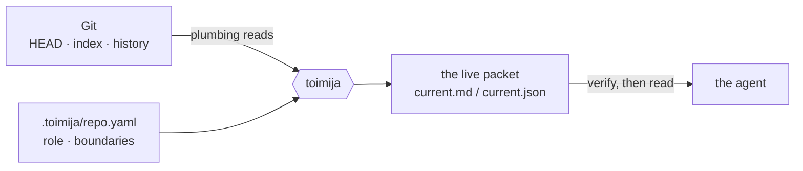
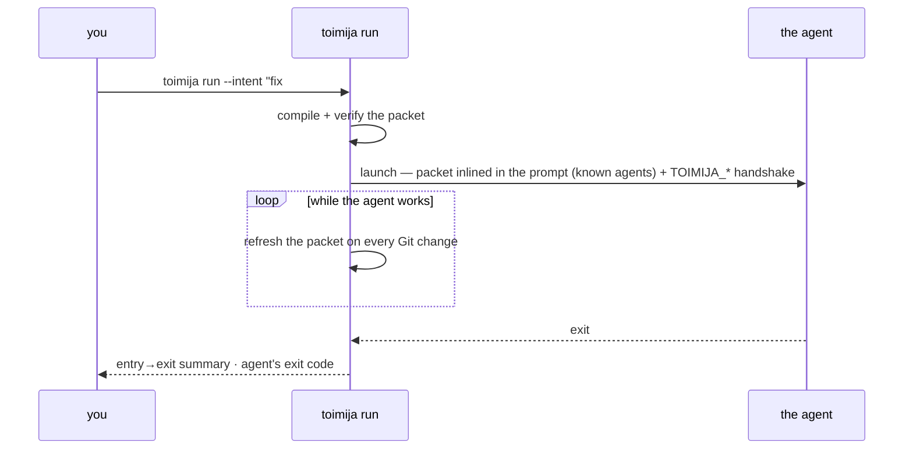
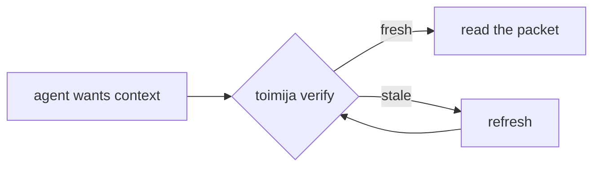
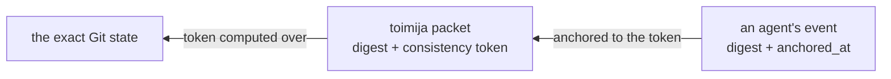

# Toimija reference

The complete manual: every command, the packet anatomy, the environment
handshake, configuration, language support, and output guarantees. For the
pitch and the 30-second start, read the [README](../README.md).

Instead of running `codex` directly, run `toimija run --intent "<why>" -- codex`.
Instead of running `claude` directly, run `toimija run --intent "<why>" -- claude`.

Toimija refreshes the repo context, writes `.toimija/current.md` and
`.toimija/current.json`, starts a watcher, launches the agent — for known
agents with the packet inlined in the launch prompt — keeps the packet fresh
while the agent works, and exits with the wrapped command's status.

> We do not ask the model to understand the repo first. We ask Git what state the repo is in.

## Toimija in 30 seconds

```bash
cargo install --path .          # or grab the release artifact
cd /path/to/repo
toimija init                    # once per repo: seed .toimija/repo.yaml
toimija run --intent "<why>" -- claude   # every time: wrap the agent
```



## Porcelain for agents

Git's own manual splits its commands into **plumbing** (stable, machine-facing
primitives: `rev-parse`, `ls-tree`, `write-tree`) and **porcelain** (the human
interface built on top: `status`, `log`, `commit`). The porcelain is just one
client of the object database underneath — anyone can write another.

Toimija is another porcelain, purpose-built for a different client: **an agent,
not a human at a prompt.** Same pipes, different sink.

That is the whole design move, and it repeats at every layer:

- **Context** is compiled from plumbing reads — no index to keep fresh, Git's
  state machine *is* the state.
- **Snapshots** are `write-tree` plus a ref — immutable, content-addressed,
  garbage-collected by git itself.
- **Freshness** is a content-based token — the same content-addressing trick
  git's object model is built on, applied one layer up.
- **Provenance** (the sauma envelope) is passive files plus a reader — the same
  shape as git itself: no service, no daemon.

Every repo already ships a battle-tested, content-addressed, distributed
database that every machine and every CI system knows how to replicate: `.git`.
Toimija refuses to build a second one. The design test for any new need is
*"does git already store this?"* — before writing a line of infrastructure.

## Why

Every coding agent enters a repo the same way: glob, grep, read, guess. That
cold crawl is slow, costs tokens, and is wrong the moment the repo moves. Yet
every repo already ships a database that knows exactly what is going on — Git.
Toimija reads it once, compiles it into a small packet, keeps that packet
verifiable against local Git state, and hands it to the agent as a bounded
starting point instead of a cold crawl.

What you get:

| | |
|---|---|
| **A live work packet** | Branch, HEAD, merge-base, changed surface, warnings — refreshed on every relevant change while the agent works. |
| **A workset contract** | Every packet opens with a normative contract: work from Scope and Read order, exclusions are do-not-scan, and any expansion outside the workset is declared — *expansion is never forbidden; invisible expansion is.* |
| **Wrapped means used** | Under `run`, using toimija is not voluntary: an explicit intent is required to launch, known agents get the packet **in their launch prompt** (argv — they cannot not-see it), and the exit summary reports what the session actually consumed. |
| **Ambient adoption** | `toimija adopt` maintains one flat instruction in every agent entry file convention, drift-guarded by `doctor --strict`; `--hooks` keeps the packet fresh on every checkout/merge/commit. |
| **Git-derived relevance** | What to inspect first, what co-changes, what is risky, and which changes may be dependency-related. Heuristic and advisory; no source parsing. |
| **Verifiable freshness** | Every packet carries a content-based consistency token; `toimija verify` proves it still matches the repo before anyone trusts it. |
| **Multi-agent awareness** | Per-session packets, `toimija sessions` presence + overlap warnings, explicit handoff records, and bounded stewardship. Visibility, never orchestration. |
| **Staged audit breadth** | `toimija audit-plan` partitions the repo into bounded, deterministic audit surfaces; committed findings are the cross-run cache — no more one enormous session re-deriving everything. |
| **Chain of custody** | Every packet and handoff carries a sauma envelope — a canonical digest plus provenance edges — so artifacts across tools verify against the exact repo state they were built from. |
| **Validation planning** | `validate --plan` prints inferred and configured commands with their provenance — full adapters for Rust/Elixir, a minimum language pack floor for Go/Python/JS-TS. It never runs commands. |
| **Squash-proof landing checks** | `toimija landed` answers "did this branch land?" by content, where ancestry lies. |

## What Toimija is

Toimija is a Git-aware local context compiler and live entrypoint for coding
agents.

It combines:

- durable repo meaning from `.toimija/repo.yaml`
- live Git state
- Git-derived relevance
- language adapter hints
- validation plans

into:

- `.toimija/current.md` — the readable live packet
- `.toimija/current.json` — the machine-readable live packet

Agents should work from those files instead of reading the repo cold.

Git is not a save button here. Git is the substrate.

> Git gives us the graph of what happened. Toimija turns that graph into operational context for agents.

## The normal workflow

```bash
cd /path/to/repo
toimija run --intent "fix #51" --task "fix the login redirect" -- codex
```

```bash
cd /path/to/repo
toimija run --intent "explore the failing CI" -- claude
```

`run` is the recommended agent entrypoint. It runs `enter`, starts `watch`,
launches the agent command, stops watching when the agent exits, and returns the
agent command's exit status (signal termination is preserved too, e.g. SIGTERM →
143).

**Wrapped means used** (proposal 0006). `run` refuses to launch without
`--intent`; `--intent unknown` remains the explicit escape hatch for
exploratory sessions. For known agents (`claude`, `codex`, `gemini`
— matched by basename; all use positional prompt delivery) — and for any agent
configured under `agents:` in `.toimija/repo.yaml` (`prompt: positional`, or a
flag such as `prompt: --message`; configuration wins over the built-ins) —
the packet is delivered **in the launch prompt
itself**: `run` appends one positional argument carrying the contract framing,
the entry packet inlined at the session budget, the live packet path, and your
`--task`. The agent cannot not-see it. Pass the agent's task via `--task`, not
as the agent's own positional argument. Unknown agents keep the env-var
handshake behind an honest banner — `delivery: env-var only — not guaranteed` —
never a silent degradation.



Use `--` before the wrapped command when you need to pass flags through
unambiguously, for example `toimija run --intent unknown -- codex --help`.

Each `run` opens a **session** with its own live packet under
`.toimija/sessions/<id>/`, so concurrent wrapped agents do not race on a single
shared file. While the agent works, that session packet stays fresh: every
relevant filesystem or Git-state change re-runs the refresh after a short
debounce. After laptop sleep, the resumed watch loop re-proves the session within
one tick through that same refresh and heartbeat path. On Linux, the watcher
polls collected Git state at roughly 500 ms because inotify can prove
the readiness probe while still missing the first post-armed event in
CI/container environments, and Toimija only needs packet-visible Git/worktree
state. This avoids recursively scanning ignored build/vendor/session trees as
the change source. On other platforms, the watcher arms the platform-native
backend first
and reports `armed (native)` only after a readiness probe is observed. If that
probe times out, it re-arms and re-proves notify's polling backend before
reporting `armed (poll fallback)`. Both event backends also compare the packet
state token periodically, so a Git state change the event stream missed cannot
leave the live packet stale. When a refresh itself fails — an unparseable
`.toimija/repo.yaml`, say — the packet cannot be rebuilt, so it says so instead:
a notice at the top of the Markdown packet names the failure and since when,
above the last good content, and the next successful refresh replaces it. The
failure is written, and logged, once per distinct error rather than on every
retry. It is
foreground-only and stops the moment the agent exits — no daemon survives the
command. The repo-level `.toimija/current.*` is kept too, demoted to a
last-writer-wins "latest" summary for sessionless readers.
While a wrapped command runs, `run` re-points its own stdout and stderr at
`.toimija/sessions/<id>/diagnostics.log` (descriptor-level `dup2`) and hands
the saved terminal to the child, so nothing this process prints — watcher
output, refresh warnings, panic messages included — can interleave with the
harness; `run` reports the captured line count and path after the command
exits. Standalone `watch`, which owns its terminal, prints those diagnostics
directly as before.

So the wrapped agent can *find* its live packet, `run` hands it an environment
handshake. For known agents this is the backup channel (the packet already
travels in the launch prompt); for everything else it is the only signal `run`
injects into the child:

| Variable | Meaning |
| --- | --- |
| `TOIMIJA_RUN=1` | The agent is under `run`; a watcher is keeping the packet fresh. |
| `TOIMIJA_SESSION` | This session's id (`<unix-secs>-<pid>`). `toimija intent`, `enter`, and `refresh` use it to find the session. |
| `TOIMIJA_LIVE` | Absolute path to this session's live `current.md` (authoritative). |
| `TOIMIJA_LIVE_JSON` | Absolute path to this session's live `current.json`. |
| `TOIMIJA_CURRENT_MD` | Alias of `TOIMIJA_LIVE`, for harnesses that key on the file name. |
| `TOIMIJA_CURRENT_JSON` | Alias of `TOIMIJA_LIVE_JSON`. |
| `TOIMIJA_REPO_ROOT` | Absolute path of the repo root the session runs in. |
| `TOIMIJA_RUN_ID` | Alias of `TOIMIJA_SESSION`. |
| `TOIMIJA_REPO_LIVE` | Absolute path to the repo-level `current.md` summary. |
| `FALSE_SYSTEMS_REPOSITORY_POINT_PATH` | Absolute path to this session's current repository point, a false-agent-protocol `RepositoryPointEnvelope` (`.toimija/sessions/<id>/semantic-point.json`), rewritten on every refresh. |

An agent that honors the handshake re-reads `$TOIMIJA_LIVE` after HEAD, branch,
index, or unfamiliar worktree changes instead of re-running `enter`; its own
expected source edits do not require a full re-read. Before commit or handoff,
`toimija verify` is the freshness boundary. `toimija snippet preflight` carries
the same rule.

Codex receives the same generated values as individual
`-c shell_environment_policy.set.<name>=<value>` arguments, so tool commands
in its persistent daemon receive this run's identity rather than depending on
the daemon's startup environment. Values are quoted as TOML-compatible strings;
unrepresentable non-UTF-8 values fail before launching. No global Codex config,
inheritance policy or sandbox setting is changed. Other agents retain the
ordinary environment handshake. Outside repositories, `TOIMIJA_STATE_DIR` is
also set to the resolved session-state location, so `intent` finds the marker
even when the daemon started with a different state directory.

Each session also writes a `.toimija/sessions/<id>/session.json` marker (id, pid,
agent argv, worktree, branch, HEAD, intent, scope, timestamps, status) that `run`
auto-closes on exit. The marker is what `toimija sessions` reads (below) and the
foundation for the `toimija handoff` record designed in
`docs/proposals/0001-sessions-awareness-handoff.md`.
The entry branch and HEAD remain fixed in later packets; if current Git state
moves, mandatory Markdown renders a `Session drift` block and JSON retains both
the entry baseline and current `git` state.

### Outside a repository

In a folder that is not inside a Git repository, `run` opens a session with no
packet instead of refusing (issue #225). There is no Git context to compile, so
there is no entry packet, watcher, repository point, effects observation, or
exit summary; a cycle leg, `--for-diff`, and `--budget` are refused. What
remains is what makes the session visible:

- the marker, under the machine-local state directory — `$TOIMIJA_STATE_DIR`,
  else `$XDG_STATE_HOME/toimija`, else `~/.local/state/toimija` — at
  `<state>/.toimija/sessions/<id>/session.json`, with `worktree` set to the
  folder. Nothing is written in the folder itself;
- a heartbeat every minute, since no watcher stamps `last_seen_at`;
- `TOIMIJA_RUN=1`, `TOIMIJA_SESSION`, `TOIMIJA_RUN_ID`, and `TOIMIJA_LIVE` /
  `TOIMIJA_CURRENT_MD` naming a short note that says why there is no packet.
  The repository-only variables (`TOIMIJA_LIVE_JSON`, `TOIMIJA_CURRENT_JSON`,
  `TOIMIJA_REPO_ROOT`, `TOIMIJA_REPO_LIVE`,
  `FALSE_SYSTEMS_REPOSITORY_POINT_PATH`) are cleared, so values inherited from
  an outer session cannot leak in;
- for known agents, a launch prompt that says there is no packet, then the task.

`toimija sessions --outside-repos` (the default when not inside a repository)
lists these sessions, and `toimija intent` finds its session there even after
the agent changes into a repository. Sessions inside the repositories the agent
touches do not count it as a sibling: its declared scope is how they can know.

## Multi-agent sessions

Several agents can work one repo at once without trampling each other's context.
Each wrapped agent gets its **own** session packet, and `toimija sessions` makes
the others visible.

Declare why you're here (and optionally what you'll touch) when you launch — it's
advisory, never an assignment or a lock:

```bash
toimija run --intent "add sessions command" --scope src/sessions.rs -- codex
```

The wrapped agent can also speak for itself, mid-session — it finds its own
marker through the `TOIMIJA_SESSION` handshake:

```bash
toimija intent "migrating the auth module" --scope src/auth/
```

Launch-time `--intent` belongs to the human; `toimija intent` lets the agent
declare (or sharpen) it once it actually knows what it is doing. Same rules:
advisory text on the session marker, never an assignment, never a lock.

Then, from anywhere in the repo, see who else is live:

```bash
toimija sessions          # human listing: LIVE / STALE / CLOSED + warnings
toimija sessions --json   # same, machine-readable (carries marker-scan coverage)
toimija sessions --prune  # run the configured stewardship pass
toimija clean --dry-run   # preview all expired Toimija-owned artifacts
```

When pausing or finishing, the wrapped agent can leave an explicit handoff
record for its own session:

```bash
toimija handoff "auth migration half done; run cargo test -p auth next"
toimija handoff --show 1782675584-99172
toimija history
```

Handoffs are append-only JSONL at `.toimija/sessions/<id>/handoff.jsonl`.
They snapshot one context packet: Git state, changed surface, suggested
validation commands, coupling/risk hints, consistency token, and the note.
The public record embeds `version: 1` and is documented by
`docs/schemas/handoff-record.v1.schema.json`; optional fields may be added in
v1, while breaking changes require a v2 schema and version bump.

Concluded sessions are distilled into the append-only
`.toimija/history.jsonl`. `run` records clean teardown immediately; pruning
journals an unrecorded closed or stale session before removing its directory.
Append failure keeps the directory. `toimija history` renders newest first;
`--json` emits every valid record as an array. Malformed lines are counted and
skipped. The v1 shape is documented by
`docs/schemas/history-record.v1.schema.json`.

```
LIVE
  claude  1782675584-99172
    branch: feat/sessions-awareness
    worktree: /Users/yair/projects/toimija
    intent: add sessions command
    scope: src/sessions.rs
    started: 12m ago
    seen: 8s ago
    packet: .toimija/sessions/1782675584-99172/current.md
    handoff: 1 record(s)

WARNINGS
  - 2 live sessions on branch feat/sessions-awareness: claude (…), codex (…)
```

`sessions` is read-only and local: it reports presence, resolves best-effort
liveness (`active` / `stale` / `closed`), exposes the separate `pid_check`
(`alive` / `dead` / `unknown`) in JSON, and warns when sessions overlap (same
branch, same worktree, intersecting declared scope, unknown intent, …).
Staleness measures **inactivity, not lifetime**: `run`'s watcher stamps a
`last_seen_at` heartbeat on the marker at every packet refresh, and a session
is stale when its process is gone or it has shown no activity for 90 minutes —
so a day-long working session stays `LIVE`, while a frozen one decays honestly
(see `docs/proposals/0002-heartbeat-staleness.md`). The
warnings are **descriptive, never prescriptive** — Toimija coordinates
visibility, not decisions. It never assigns work, signals or kills an agent, or
touches the network. The human remains the orchestrator. Prefer separate
worktrees for true isolation: same codebase, separate sessions.

Toimija-owned working artifacts do not accumulate forever. `toimija clean`
runs one stewardship pass over closed or stale sessions past retention (live
and unreadable sessions are never touched), old `.toimija/runs/*` transcripts,
and exact `*.tmp-{pid}-{sequence}` atomic-write leftovers older than one hour.
Sessions are journaled before deletion; append failure keeps the directory.
`--dry-run` lists the same candidates without deleting or compacting anything.
`enter` and `run` invoke that pass at the end of setup when `auto_sweep` is
enabled; those automatic sweeps log one warning and never fail the command.
`sessions --prune` remains available and uses the same implementation.
The pass never enters a symlink: when `.toimija`, `.toimija/sessions`, or
`.toimija/runs` is anything but a real directory it refuses outright (an
explicit `clean` fails and says why), and nothing is deleted unless its parent
resolves inside the repository's own `.toimija/`.

The same holds for everything Toimija writes. Every directory it writes into
under `.toimija/` must be a real directory, checked from the repository root
down; files are opened with `O_NOFOLLOW` and replaced by rename, so a symlink
is refused or replaced, never written through. A committed `.toimija ->
../elsewhere` makes `enter`, `refresh`, `run`, `init`, `snapshot --lease`, and
`clean` fail loudly and write nothing. The agent entry files `adopt` edits may
be symlinks within the repository (`CLAUDE.md -> AGENTS.md`), never out of it.

When the agent exits, `run` prints a one-glance session summary to stderr —
diffing the Git state from entry to exit so you see what the session actually
did (a switched branch, a moved HEAD, the working tree it leaves behind,
branch scope since the merge-base, refresh count), plus a consumption report
built purely from toimija-owned state — the session marker and handoff
records, never anything observed about the agent — so non-use is visible
instead of silent:

```
toimija run: session summary
  branch:    main → feature/login
  HEAD:      a1b2c3d → e4f5a6b (moved)
  worktree:  2 staged, 1 unstaged, 0 untracked
  scope:     4 file(s) changed on this branch since merge-base
  refreshed: 12 time(s) while you worked
  intent:    "add login flow" (declared at launch)
  expansions: 2 scope path(s) declared while working
  handoff:   1 record(s)
```

## Verify before read — the packet is a claim, not a hope

A context packet is only useful while it still matches the repo. A map an agent
trusts *after* the territory moved is worse than no map. So Toimija makes
freshness checkable instead of assumed, in three escalating moves:



1. **Fingerprint.** Every packet embeds a `toimija-consistency-v2` token — a
   deterministic, content-based fingerprint of the repo's work state (HEAD,
   index, unstaged tracked content, untracked content, conflicts, in-flight Git
   operations). No clocks, no mtimes, no file sizes: same content, same token.
   Generated state under `.toimija/` and `.teko/` is excluded so refreshes,
   sessions, snapshots, and harness runs never invalidate the packet (`.teko/`
   stays a generated-state namespace in faija's tree-identity.v1); `.toimija/repo.yaml` is the exception and always counts.
2. **Gate.** `toimija verify` (or `toimija current --verify --json` for
   machines) verifies the ambient session packet when wrapped by `run`, and the
   repo-level packet otherwise. `--packet <path>` selects one explicitly. It
   recomputes the fingerprint against the live repo and exits
   non-zero, with reasons, when the packet is stale, missing, unsupported,
   unsafe, or unverifiable. A harness calls this before *every* packet read:
   pass → trust the packet; fail → refresh first. `run` performs the same check
   on its own entry packet before launching the agent. It retries one startup
   race, then refuses to launch if the packet is still stale, unverifiable, or
   Git is in an in-progress operation or conflict state.
3. **Freeze.** When "fresh right now" is not enough — a reader that must see
   one coherent version while the worktree keeps moving — `toimija snapshot`
   materializes the working tree (untracked included) as an immutable,
   content-addressed git tree object. Files are then readable *at that version*
   via `git cat-file`, and `--lease` pins the snapshot against `git gc` until
   released.

The token is a transaction version, not a timestamp: verify tells you whether
the world changed, snapshot gives you a world that cannot change. Either way,
nothing reads repo state on faith.

## Chain of custody — the sauma envelope

Work done by agents should be auditable the way commits are: *what produced
this, from what state, and does it still verify?* Toimija's packets and handoff
records carry a **sauma envelope** for exactly this — a small, versioned
attestation block (current schema `sauma-envelope.v2`; legacy v1 remains readable,
design in `docs/proposals/0003-sauma-attested-artifacts.md`):

- **`digest`** — sha256 over the artifact's canonical form: compact JSON with
  object keys sorted at every level. Canonical means *portable*: any tool, in
  any language, recomputes the same digest from the same content — a foreign
  walker can verify an artifact it did not produce.
- **`provenance`** — typed edges to what the artifact was built from (a git
  state, a consistency token, another artifact). The edge vocabulary is an
  **open enumeration**: readers must tolerate kinds they do not know.
- **`producer` + `anchored_at`** — who wrote it, pinned to which consistency
  token.

Because every envelope anchors to a consistency token, artifacts from
*different tools* link into one verifiable chain:



That chain reads: *this review was produced against this exact packet, which
was compiled from this exact repo state* — git-blame for agent decisions.
Convention first, deliberately: joining the chain means writing one JSON block
correctly, not importing a library or calling a service. There is no provenance
daemon, no graph database, no index — passive files plus a reader, the same
shape as git itself.

`cargo xtask sauma-why <digest|token|session-id>` is the in-repo dev walker: it
verifies local sauma artifacts, renders verified token/digest links as an
indented chain, tolerates unknown provenance edge kinds, and reports digest
mismatches without walking through them.

## One-time repo setup

```bash
toimija init            # seed .toimija/repo.yaml (never overwrites)
toimija adopt --hooks   # preamble into agent entry files + refresh hooks
```

`init` creates the durable repo manifest, `.toimija/repo.yaml` — fill in
`role`, `not`, and `boundaries`; only a human can supply the repo's purpose
and limits. The generated packets (`.toimija/current.*`) belong in
`.gitignore`; they are not committed.

`adopt` puts one unconditional instruction — read `.toimija/current.md`
first — into every agent entry file already present (`AGENTS.md`,
`CLAUDE.md`, `.cursorrules`, `.github/copilot-instructions.md`, `GEMINI.md`,
`.rules`), inside a marker-delimited block it maintains idempotently. See
**Adopt the entry layer** below. `toimija snippet preflight` still prints
extra preflight prose to paste by hand, and `toimija snippet script` prints a
`scripts/agent-enter` stub — both optional once a repo is adopted.

> repo.yaml gives durable meaning. Git gives live work state. Toimija compiles both into current context.

## Current context

`.toimija/current.md` is the readable live packet. `.toimija/current.json` is the
machine-readable live packet. Both are regenerated by `refresh`, `enter`, `watch`,
and `run`, and are git-ignored.

The packet includes:

- an **artifact ID** shared by the Markdown/JSON pair; each file is atomically
  replaced, and JSON is authoritative if an interrupted refresh leaves IDs that
  do not match
- branch / HEAD / dirty state
- staged / unstaged / untracked files
- rename/copy origin paths and similarity when Git reports them, plus conflict
  index stages (mode and object ID)
- collection **coverage** on the branch diff and history relevance stages
  (`available` / `degraded` / `failed` with a reason and source), so an empty
  list from a failed collection is never presented as a real observation
- changed surface
- scope
- read order
- coupling
- risk
- validation plan
- warnings
- on per-session packets, a **session** block — the session's id, declared
  intent and scope, freshly read at each refresh (so `run --intent` and
  `toimija intent` reach wrapped harnesses), the entry branch and HEAD, and an
  `execution` context carrying the session's repository point and changed
  surface (Kelpo reads `session.execution.repository` to bind evidence to a
  session)
- a **consistency** block — a versioned `toimija-consistency-v2` freshness token
  over HEAD, staged/index state, unstaged tracked state, untracked state,
  conflict state, and unsafe Git operation state
- a **refresh token** over the collected Git state — repository state only,
  never anything read from the observer's environment, so the same repo yields
  the same token from any process — used by `watch` and `verify`
- a **sauma** envelope — a local attestation digest and provenance edge set for
  the packet artifact

See **Verify before read** for what the token buys you, **Chain of custody**
for what the envelope buys you, and **Example context output** below for a full
rendering.

## Commands

Ordered by workflow:

```bash
toimija run --intent "..." -- codex   # agent entrypoint (intent is required)
toimija run --intent "..." --task "..." -- claude  # task travels in the launch prompt
toimija run --intent "..." --scope src/x.rs -- codex  # declare what you'll touch (advisory)
toimija sessions           # who else is live in this repo (read-only awareness)
toimija intent "..."       # wrapped agent declares why it is here (via TOIMIJA_SESSION)
toimija handoff "..."      # wrapped agent appends a session handoff record
toimija handoff --show ID  # read a session's handoff records
toimija history            # durable records of concluded sessions
toimija clean --dry-run    # preview the unified stewardship sweep
toimija clean              # reclaim expired owned artifacts
toimija enter              # refresh + print the packet as agent preflight
toimija refresh            # recompute current.md/current.json
toimija watch              # keep current.* fresh on Git/filesystem changes
toimija context            # print the packet without wrapping an agent
toimija context --json
toimija current --write    # synchronously write current.md/current.json
toimija current --verify --json  # machine-readable verify-before-read gate
toimija verify             # does the selected session/repo packet still match?
toimija snapshot           # freeze the worktree as an immutable git tree (content @ version)
toimija audit-plan         # derive bounded, read-only audit surfaces from Git
toimija audit-plan --surface 3 --budget 4000  # print one audit workset packet
toimija adopt              # install the canonical agent-entry preamble
toimija adopt --hooks      # also install best-effort Git refresh hooks
toimija validate --plan    # print the validation plan; never runs it
toimija repository-point --json  # the exact current repository point
toimija doctor             # check Toimija setup
toimija init               # create .toimija/repo.yaml if missing
```

| Command | What it does |
|---|---|
| `run <cmd>` | Agent entrypoint: enter, watch, launch command, return command status. `--intent` is required (`--intent unknown` is the escape hatch); `--task` travels in the composed launch prompt of known agents; `--scope` declares what you'll touch (advisory). Use `--` before child flags. Exit summary includes the consumption report. Outside a repository: a session with no packet (see "Outside a repository"). |
| `sessions` | List sibling sessions live in this repo (read-only awareness); `--json` for machine output; `--prune` runs the same configured stewardship pass as `clean`; `--outside-repos` (the default outside a repository) lists sessions opened outside any repository. |
| `intent "<text>"` | Wrapped agent declares/updates its own session's intent (and `--scope` paths) via the `TOIMIJA_SESSION` handshake. Advisory, never a lock. |
| `handoff ["<note>"]` | Wrapped agent appends an explicit JSONL handoff record for its own session. `--show <id>` reads records, including closed sessions; `--json` emits the written record or all shown records. |
| `history` | List durable concluded-session records newest first; `--json` emits every valid record. Malformed lines are counted and skipped. |
| `clean` | Reclaim expired sessions, run transcripts, and exact orphan temp files; `--dry-run` lists candidates without mutation. Explicit cleanup propagates errors. |
| `enter` | Refresh and print the current packet as agent preflight. |
| `refresh` | Recompute `current.md`/`current.json`. |
| `current --write` | Joskus-facing alias for synchronous packet refresh. |
| `current --verify --json` | Joskus-facing structured verification command. |
| `watch` | Keep `current.md`/`current.json` fresh on Git/filesystem changes. |
| `context` | Print the context packet without wrapping an agent. |
| `verify` | Check that the ambient session packet (or repo packet when sessionless) still matches the live repo; `--packet` selects one explicitly. Exits non-zero when not verified. `--json` includes the selected path, digest, and token. |
| `snapshot` | Materialize the working tree as an immutable git tree object (content addressed at the current token), so a reader can read files *at a version*. `--lease`/`--release <id>`/`--list` pin a snapshot (a git ref) so `git gc` retains it while held; a lease id is 1-128 ASCII letters, digits, `.`, `-`, or `_`, not starting with `.`, and anything else is refused before anything is touched; `--json` emits the snapshot record. Refuses in an unsafe git state. |
| `audit-plan` | Derive deterministic, bounded audit surfaces from the committed Git tree; `--surface K` prints one contract-framed workset, and prior findings are read-only pointers to the latest committed `docs/audit/<date>/` directory. No plan or findings are written. |
| `adopt` | Install the same marker-delimited Toimija preamble in every known entry file already present, creating `AGENTS.md` only when none exists; `--hooks` adds best-effort Git refresh hooks and creates/merges the repo-local `.claude/settings.json` SessionStart hook. |
| `validate --plan` | Print the validation plan; never runs validation. |
| `repository-point` | Export the exact current repository point (repository ref, point ref, tree OID, consistency token, branch, dirty) as a false-agent-protocol v1 `RepositoryPointEnvelope`; `--json` for tools. |
| `doctor` | Check Toimija setup (`--strict` gates on config/doc drift). |
| `landed` | Report whether a branch's work is present in a base ref, by content. |
| `init` | Create `.toimija/repo.yaml` if missing. |
| `snippet preflight\|script` | Print suggested preflight text / entry script; writes no files. |

`--for-diff` and `--budget` tune the packet; `--json` switches the print commands
(`context`, `enter`, `refresh`) to JSON. Global options: `-v/--verbose`,
`-q/--quiet`, `--log-format text|json`, `--no-color`. Logs go to stderr; command
output goes to stdout.

## Staged audit breadth (`toimija audit-plan`)

For a repository-wide audit, use one bounded pass at a time. The plan derives
top-level Git tree areas, file counts, and churn from the last 200 non-merge
commits, then greedily packs them into deterministic surfaces (at most eight
by default, targeting roughly 150 files each):

```bash
toimija audit-plan
toimija audit-plan --surface 3 --budget 4000
```

The surface packet carries the same Workset contract as the context packet, a
consistency token, its authoritative area boundary, the inferred validation
plan, and warnings. It also lists files from the lexicographically latest
committed `docs/audit/<date>/` directory so a later pass can read conclusions
before re-deriving them. `audit-plan` never writes a plan or findings; the
auditing agent commits findings to Git. Configured exclusions remain do-not-scan.

## Boundaries / non-goals

The boundaries are the feature: Toimija stays fast, predictable, and safe to
wrap around anything because of what it refuses to do. They are structural, not
aspirational — `doctor --strict` fails the build when the config and the agent
docs drift apart on them.

Toimija does not:

- execute validation or checks of any kind (`validate --plan` only prints the
  plan; checks and their receipts are Evidence, which sykli owns)
- decide: assign work, judge completion, or close anything — Toimija reports
  facts and refuses to decide
- auto-commit or auto-stash
- fetch from the network
- run as a hidden daemon (`watch`/`run` are foreground-only and explicitly invoked)
- own `AGENTS.md` / `CLAUDE.md` (the explicitly-invoked `adopt` maintains one
  marker-delimited block inside them; the prose around it stays yours)
- observe or police what a wrapped agent reads or does mid-session — delivery
  is structural at launch, evidence is reported at exit, nothing in between
- parse code with Tree-sitter
- use LSP / SCIP / Kythe / MCP in the current workflow

Default posture is advisory: it warns and explains; it does not block humans. The
one opt-in gate is `doctor --strict`.

## Ownership: `.toimija/` is Toimija's, root files are yours

Toimija should not own agent policy; it should make agent work cheaper by keeping
a live, repo-aware context layer an agent asks for before it works.

```text
.toimija/repo.yaml      owned by you        durable repo meaning (boundary + validation hints)
.toimija/current.md     owned by Toimija    repo-level live packet / latest summary (regenerated, git-ignored)
.toimija/current.json   owned by Toimija    repo-level machine-readable packet (regenerated, git-ignored)
.toimija/sessions/      owned by Toimija    per-session live packets, markers, handoff records from `run`/`handoff` (regenerated, git-ignored)
.toimija/runs/          owned by run harnesses  retained transcripts (14 days by default)
.toimija/history.jsonl  owned by Toimija    bounded durable memory of concluded sessions
AGENTS.md               owned by you        agent policy — Toimija maintains only its marker-delimited `adopt` preamble inside it
CLAUDE.md               owned by you        agent policy — same: your prose around Toimija's markers
scripts/                owned by you        e.g. agent-enter — Toimija only suggests text
```

`toimija init` writes `.toimija/repo.yaml` and nothing else; on a fresh config
it prints a **Next steps** line pointing at the identity fields you still need
to fill. Agent policy files stay human-owned: `toimija adopt` (explicitly
invoked, never automatic) maintains exactly one marker-delimited block inside
them — everything outside the markers is yours, malformed markers are refused
rather than rewritten, and `adopt` creates `AGENTS.md` only when no known
entry file exists at all.

## Git-derived relevance

Toimija does not only report Git state. It also uses bounded Git history to help
an agent decide what to inspect first:

- changed areas since merge-base, and areas untouched by the branch
  (`Compiled workset`)
- changed files ranked by likely relevance with a short reason (`Read order`);
  source churn corroborated as dependency-bump fallout (a changed manifest whose
  ecosystem lockfile changed in the same diff, e.g. `Cargo.toml` + `Cargo.lock`)
  is tagged `possible dependency-related change` and ranked after the manifest
  for inspection. This is a weak heuristic, never evidence that source is safe
  to skip. Conservative by design: a manifest or
  lockfile edit alone tags nothing, and files the branch itself added are always
  authored intent, never ripple.
- companion files that are missing from the current diff (`Coupling`)
- files with high churn or young surface, plus a concrete action hint (`Risk`)

> This is not semantic code understanding. It is Git-derived work relevance.

> Tree-sitter can help after you know where to look. Toimija uses Git to decide where looking is worth it.

These hints are advisory. They come from `git ls-tree`, `git log`, `git diff`, and language adapter path heuristics (no source parsing, no network, no index). Every coupling and risk hint carries its source, supporting observations, total observations, and a conservative confidence grade; the same fields are structured in JSON as `evidence.support`, `evidence.observations`, and `evidence.confidence`. History mining is bounded: the last 200 non-merge commits, starting from the merge-base so the branch does not vote on its own relevance. Historical coupling needs a missing partner to co-change at least twice and in at least 60% of the changed file's edits; existing companion tests are surfaced through path heuristics. "High churn" means at least 8 commits touched the file in that window. A file being untouched is not enough evidence to call it stable or load-bearing, so Toimija stays silent. Sections are capped (read order grouped, coupling and risk at 5). On a shallow clone or a repo with no history these sections are omitted and a `Relevance history unavailable` warning is emitted.

## Validation

`toimija validate --plan` prints commands. It never runs them.

The plan has tiers — `Focused` (derived from the changed surface), `Fast`,
`Strict`, `Full`, and `Privileged` — drawn from `.toimija/repo.yaml`'s
`validation` section, or inferred from the repo kind when the config leaves
them empty. The agent runs the commands itself and reports the exact output.

Two languages have full adapters (Rust, Elixir: inferred tiers plus the
focused per-unit heuristics below). Go, Python, and JS/TS get the **minimum
language pack** — a data table, not a module: manifest detection (`go.mod`,
`pyproject.toml`/`setup.py`, `package.json`), inferred test + lint tiers
(`go test ./...`/`go vet ./...`, `pytest`/`ruff check .`, `npm test`/`npm run
lint`/`npm run typecheck`), and companion-test hints (`foo.go` → `foo_test.go`,
`foo.py` → `test_foo.py` or `tests/test_foo.py`, `foo.ts` →
`foo.test.ts`/`foo.spec.ts`, existence-checked). Node commands require matching
string-valued scripts; Python commands require explicit pytest and Ruff
configuration. Unproven candidates are omitted with a note. Full adapters
outrank minimum packs in polyglot repos, minimum-pack plans carry the honest
`minimum language pack` note, and `repo.yaml` validation config beats inference
everywhere. Adding a language is one `RepoKind` variant plus one table row in
`src/adapters/pack.rs`; a language gets a dedicated adapter only when it needs
project-aware behavior such as Rust workspace or Elixir umbrella scoping.

Context packets also report secondary languages found by a manifest-only walk
bounded to depth 3 and 4096 entries. The walk honors configured exclusions,
hard-skips `.git` and vendored/build trees, and never follows symlinks. Nested
manifests of the primary kind are suppressed; every other observation is
report-only and cannot add validation commands.

Other languages are still useful through repository configuration. For example,
a Java repository can keep its build tool's commands explicit in
`.toimija/repo.yaml`:

```yaml
validation:
  fast:
    - ./gradlew test
  strict:
    - ./gradlew check
  full:
    - ./gradlew build
```

Maven repositories can use `./mvnw test`, `./mvnw verify`, and
`./mvnw package` instead. This keeps validation honest: Toimija renders the
commands but never runs them. A built-in Java minimum pack, or support for
another language, should add one data row with its root manifest, test and lint
commands, source extensions, and existence-checked companion-test templates;
do not add a language-specific adapter module.

The `Focused (from changed surface)` tier is derived, not configured: for a Rust repo it maps changed `.rs` files to their owning crate (the nearest enclosing `Cargo.toml`) and emits `cargo test -p <crate>` for a fast first pass, deduped per crate and rendered above the authoritative `Fast` tier. For an Elixir umbrella it maps changed `.ex`/`.exs` files to their owning app (`apps/<name>/`) and emits `mix test apps/<name>/test`; a single-app mix repo gets no focused tier, since `mix test` already is the whole run. It is advisory and additive — never a substitute for the full run. When only manifests or docs change, or a change spans more units than the cap, the tier is omitted and the whole-repo command stands.

## `doctor --strict` — the drift guard

Plain `toimija doctor` is advisory: it reports setup gaps as warnings and exits
`0`. `toimija doctor --strict` escalates every actionable warning to a failure and
exits non-zero, so a CI step or pre-commit hook can block drift. It is a lexical
drift guard — no AI, no semantic comparison. It checks:

- `.toimija/repo.yaml` exists and parses
- `repo.name`, `repo.role`, and `boundaries` are non-empty
- a validation plan exists (configured or inferable from the repo kind)
- every `context.important_docs` path exists on disk
- an agent doc still routes work through the `toimija enter` preflight
- each boundary sentence still appears in the agent docs
  (`AGENTS.md` / `CLAUDE.md` / `important_docs`), matched case- and
  whitespace-insensitively so re-wrapping a line does not trip the gate
- every known agent entry file that exists carries the current `toimija adopt`
  preamble, matched whitespace-insensitively like the boundary sentences, so a
  formatter re-wrapping the preamble line does not trip the gate

```bash
toimija doctor --strict
```

## Adopt the entry layer (`toimija adopt`)

Adoption puts one unconditional instruction in the entry files agents already
use. It is marker-delimited and idempotent; rerunning the command replaces only
Toimija's block. If no known entry file exists, it creates `AGENTS.md`; otherwise
it amends only files already present:

```bash
toimija adopt
toimija adopt --hooks
```

With `--hooks`, `post-checkout`, `post-merge`, and `post-commit` run
`toimija refresh` best-effort with Git repository-location variables scrubbed.
Foreign hooks are never overwritten. The command also creates or merges the
repo-local `.claude/settings.json` SessionStart hook:

```text
wrote .claude/settings.json (SessionStart: toimija context)
```

Existing settings and hooks are preserved, and rerunning is byte-for-byte
idempotent once the hook exists. Malformed settings are refused without
rewriting the file. Toimija never writes config outside the repository;
`~/.claude/settings.json` stays yours. A doctor drift check for this settings
hook is deliberately deferred until adoption evidence shows it is useful.

## Did the work land? (`toimija landed`)

"Did my branch land?" is a **content** question, not an ancestry question. Under
squash merges this matters: a squash-merge synthesizes a fresh commit with no edge
back to your branch tip, so `git merge-base --is-ancestor <tip> origin/main`
reports `false` even when every line landed. Patch-id checks (`git cherry`) fail
too, because squash fuses commits. Only tree/content comparison survives both.

`toimija landed` answers per touched path: is the branch's *own change* to it
already present in the base ref (default `origin/main`)? For each path it asks git
whether the branch's change applies cleanly forward onto base (so it is still
absent → not reflected), reverse-applies (so it is exactly present → reflected), or
neither — meaning base has diverged on that file. The diverged case is reported as
**ambiguous**, never silently as landed: a false "landed" is the dangerous
direction for branch cleanup. A line-containment heuristic (are the lines the
branch added present, and the lines it removed gone?) rides along as *evidence* on
the ambiguous entry, but does not decide the verdict.

```bash
git fetch                         # re-validate against live state first
toimija landed --base origin/main
```

```text
Toimija landed

- base: origin/main
- branch: feat/doctor-strict-drift-guard (a13296a)
- status: landed
- reason: all 7 touched path(s) are reflected in `origin/main`
- reflected: 7/7
```

Status is `landed` (every touched path's change is proven present), `not landed`
(all proven absent), `partially landed` (a clean split of reflected and not),
`ambiguous` (base diverged on at least one path, so landing could not be proven —
the paths and their heuristic evidence are listed), or `unknown` (no merge-base —
unrelated histories or an unfetched base). The check runs against a scratch index
seeded from the base, so it never touches your index or working tree. Useful for
stacked PRs: after a parent merges via squash, check a child with `toimija landed`
rather than trusting ancestry.

## Example context output

`toimija context` (and the `.toimija/current.md` written by `refresh`/`enter`)
renders like this:

```text
# Toimija Context
- compiled-from: 3 changed file(s), 2 recent commit(s), 4 relevance hint(s) — reading this replaces that discovery

## Repo
- name: toimija
- role: internal CLI that compiles local Git context for coding agents
- not: platform, dashboard, dispatcher
- kind: Rust

## Workset contract
Work from this packet's Compiled workset and Read order; they are your working
set, not a preamble. A session's declared scope is intent, not evidence.
Configured exclusions are do-not-scan. You MAY read outside the
workset when a concrete unresolved dependency requires it — but you MUST
declare the expansion first: `toimija intent "<why>" --scope <path>` (or, if
you are not under a session, state the expansion and its reason in your
visible output). Expansion is never forbidden; invisible expansion is.

## Git
- branch: feat/git-ceramics
- HEAD: abc123
- detached: false
- upstream: unavailable
- merge-base: origin/main @ def456
- dirty: true
- staged: 0
- unstaged: 2
- untracked: 1
- conflicts: 0

## Git state
Toimija starts from Git's state machine: HEAD, index, working tree, branch, and merge-base.

## Branch surface
- compared against: origin/main
- merge-base: def456
- files changed since merge-base: 3

## Compiled workset
- source: branch diff since merge-base
- in play: README.md, src, tests
- unchanged top-level areas: .github, fixtures, xtask

## Read order
1. README.md — changed docs
2. tests/git_state.rs — tests
3. src/git.rs, src/render.rs — source files

## Read first
- README.md (important doc)

## Validation plan
- source: inferred
### Focused (from changed surface)
- derived from the changed surface — a fast first pass, not a substitute for the full run
- cargo test -p toimija
### Fast
- cargo test --workspace
### Strict
- cargo fmt --check
- cargo clippy --workspace --all-targets -- -D warnings
### Full
- cargo test --workspace
### Privileged
- none
### Notes
- Validation inferred from Rust repo shape, not proven by Sykli

## Warnings
- No upstream detected. Branch divergence is unavailable.
- Untracked files exist. They will not be committed unless added.
- Working tree has unstaged changes.

## Configured exclusions
- target/

## Changed surface
- source: branch diff since merge-base
- 3 files — see Read order

## Coupling
- src/git.rs changed, but tests/git_state.rs was not — companion test exists but is not in this diff — confirm intentional [source: file-pattern heuristic; evidence: 1/1; confidence: medium]

## Risk
- src/render.rs — high churn — 9 commits in the last 200 commits; hot file — keep the change small and well-tested [source: git log history; evidence: 9/200; confidence: high]
- tests/git_state.rs — added on this branch — new surface; new surface without a changed companion test — consider adding coverage [source: branch diff since merge-base; evidence: 1/1; confidence: high]

## Recent commits
- abc123 feat: make Git state explicit
- def456 feat: add config-driven context rules

## Working tree
### Staged
- none
### Unstaged
- modified src/git.rs
- modified src/render.rs
### Untracked
- tests/git_state.rs
### Conflicts
- none

```

## Config

`.toimija/repo.yaml` is the durable repo manifest. Build and vendor directories (`target`, `_build`, `deps`, `node_modules`, `vendor`) are filtered from the changed surface automatically, matched as a path segment anywhere in the tree (so nested `test_projects/app/target/` is caught too). This is applied live each run — not written into `repo.yaml` — so it tracks the repo as its kind changes. `context.safe_to_ignore` is for your own additional rules on top.

```yaml
repo:
  name: toimija
  role: internal CLI that compiles local Git context for coding agents
  not:
    - platform
    - dashboard

context:
  default_budget: 8000
  important_docs:
    - README.md
    - AGENTS.md
  read_first:
    - docs/architecture.md
  safe_to_ignore:
    - target/
    - _build/
    - deps/

validation:
  replace_inferred: false
  fast: []
  strict: []
  full: []
  privileged: []

stewardship:
  auto_sweep: true
  sessions_retention_days: 7
  runs_retention_days: 14
  history_max_records: 500

boundaries:
  - Keep the core as a single Rust crate.
  - Do not add MCP, LSP, SCIP, Tree-sitter, network calls, or background daemons yet.
```

`context.read_first` adds repo-specific files to the Read first section when they exist.
`context.safe_to_ignore` lists directory rules that are omitted from the changed surface and read-first hints. Each rule is matched as a path segment (or contiguous segment sequence) anywhere in the tree, not just at the repo root.
Configured validation commands are added to the inferred Rust or Elixir tiers by default and duplicate commands are removed without reordering them. Set `validation.replace_inferred: true` only when the repository config intentionally defines the complete plan; the plan source and notes make that replacement visible.
Stewardship values are optional and default to the values above. Retention and
history limits must be greater than zero; invalid values are refused and
reported by `doctor` instead of being silently clamped. `auto_sweep: false`
disables only the best-effort `enter`/`run` hook; explicit `clean` and
`sessions --prune` still work.

## Build from source & development

```bash
cargo build
cargo run -- context        # run locally
cargo install --path .      # install the binary from this checkout
```

Release artifacts are built by GitHub Actions when a `v*` tag is pushed. The
workflow runs on False Systems ARC/Hetzner ARM64 runners and uploads a Linux
aarch64 binary as a workflow artifact.

Run the standard gate before claiming completion:

```bash
cargo fmt --check
cargo clippy --all-targets -- -D warnings
cargo test
```

### Pre-commit hook

A `xtask` crate provides a git pre-commit hook via
[`devx-pre-commit`](https://docs.rs/devx-pre-commit). It is dev-only and kept out
of the shipped binary by `default-members = ["."]` in the workspace, so bare
`cargo build`/`test`/`clippy` and the release build never compile it. Install the
hook once per clone:

```bash
cargo xtask install-pre-commit-hook
```

The hook formats the staged Rust crates, re-stages the result, then runs
`cargo clippy --all-targets -- -D warnings` followed by `cargo test`, blocking the
commit if either fails — the same gates CI enforces. Re-run the command after
editing `xtask`.

## Current limitations

- Git state is collected through the Git CLI, not Git internals.
- Merge-base is attempted against the selected base candidate.
- Validation plans are rendered only; commands are not executed.
- The primary language uses root marker files (Cargo.toml, mix.exs, go.mod, pyproject.toml/setup.py, package.json); full adapters outrank minimum packs. Secondary markers are reported from the bounded walk but do not affect planning.
- Context budgets are approximate UTF-8 byte caps, not token counts. Identity,
  Git state, the workset contract, validation, warnings, exclusions, and the
  changed-surface summary are mandatory and may exceed a very small budget.
  Optional sections are included whole or named under `Budget omissions` with
  exact item counts; the companion JSON packet remains complete.
- Impact analysis is not yet available.
- Upstream and merge-base may be unavailable in shallow, unborn, detached, or local-only repos.

## Output stability

Context packets use explicit ordering rules so agents can diff and consume them predictably:

- the changed surface unions working-tree changes (staged, unstaged, untracked) with files changed by commits on this branch since the merge-base, so a clean tree on a feature branch still reports its diff
- changed files are sorted by path and deduplicated in the changed surface
- read-first entries are grouped as changed files, matching-test hints, then configured docs
- warnings are sorted and deduplicated
- Markdown output uses a fixed heading hierarchy: top-level sections are `##`, sub-blocks (e.g. Staged/Unstaged under Working tree) are `###`, and a blank line precedes every top-level section
- every packet carries a normative `Workset contract` section (proposal 0005), rendered early so budget truncation cannot drop it: work from the Git-derived Compiled workset and Read order, treat declared session scope as advisory intent, treat exclusions as do-not-scan, and declare any expansion outside the workset (`toimija intent --scope`) instead of reading invisibly
- mandatory Markdown sections (`Git`, `Compiled workset`, `Read order`, `Read first`, `Validation plan`, `Warnings`, `Configured exclusions`, and `Changed surface`) are never displaced by optional history or working-tree detail
- optional Markdown sections are selected atomically; omitted sections are named with exact item counts and the full JSON evidence path/command
- Markdown list sections are capped at 25 entries with an honest `... and N more (truncated)` line, so a large working tree cannot hide later sections
- empty values are rendered honestly: `none` for an empty-but-known list, `unavailable` for a value Git could not determine
- Git paths are read from NUL-delimited byte output. JSON keeps existing UTF-8
  paths as strings; on Unix, a non-UTF-8 path is encoded as
  `{ "bytes_hex": "..." }`. Markdown escapes tabs, newlines, control characters,
  backslashes, and invalid bytes so a filename cannot forge output structure.
- Markdown and pretty JSON output have exact regression tests

`toimija context --for-diff` adds a diff-focused Markdown section that separates committed files changed since the selected merge-base, staged, unstaged, untracked, and conflicted files.

## Read-first heuristics

Read-first hints are bounded and path-derived. Toimija does not scan the whole repo or parse source code.

Rust:

- changed Rust files are included directly
- `src/foo.rs` may point to `tests/foo.rs`, `tests/foo_test.rs`, `src/tests.rs`, or `src/foo_test.rs` if present
- `src/foo/bar.rs` may point to `tests/foo/bar.rs` and nearby sibling test files if present
- `src/foo/mod.rs` may point to `tests/foo.rs` or `tests/foo_test.rs` if present

Elixir:

- changed Elixir files are included directly
- `lib/foo/bar.ex` may point to `test/foo/bar_test.exs` if present
- `mix.exs` may point to `test/test_helper.exs` if present

Minimum language packs (Go, Python, JS/TS) use existence-checked path
templates: `pkg/foo.go` → `pkg/foo_test.go`; `src/foo.py` → `src/test_foo.py`
or `tests/test_foo.py`; `app/foo.ts` → `app/foo.test.ts` or `app/foo.spec.ts`.
Files that are themselves tests (matched by anchored patterns, e.g.
`*_test.go`) are never hinted at themselves.

## Future drawer

These are intentionally not implemented:

- MCP server
- Tree-sitter, LSP, SCIP, Kythe
- Sykli, Vaisto, or Kerto integration
- checkpoint and worktree management
- cross-repo / multi-repo coordination
- dynamic plugins
- graph database
- background daemons
